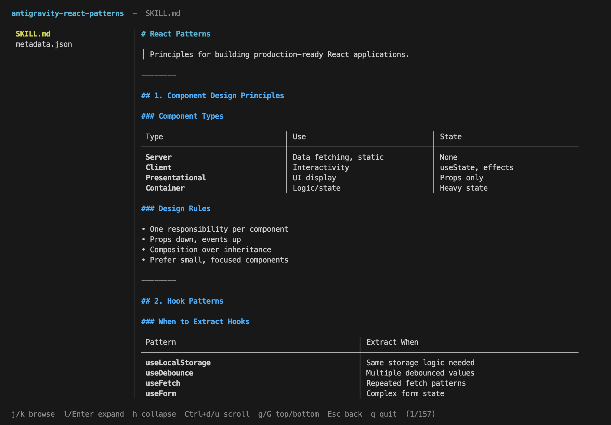
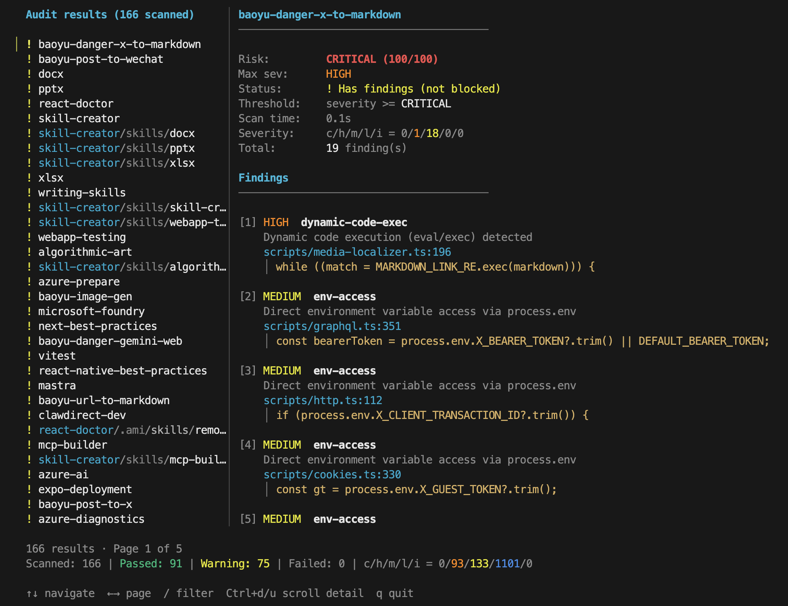
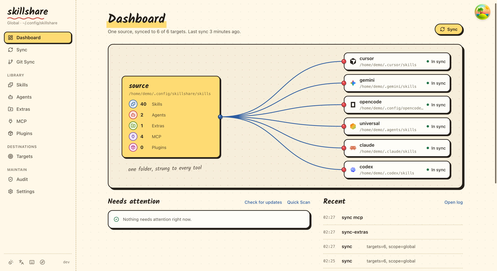
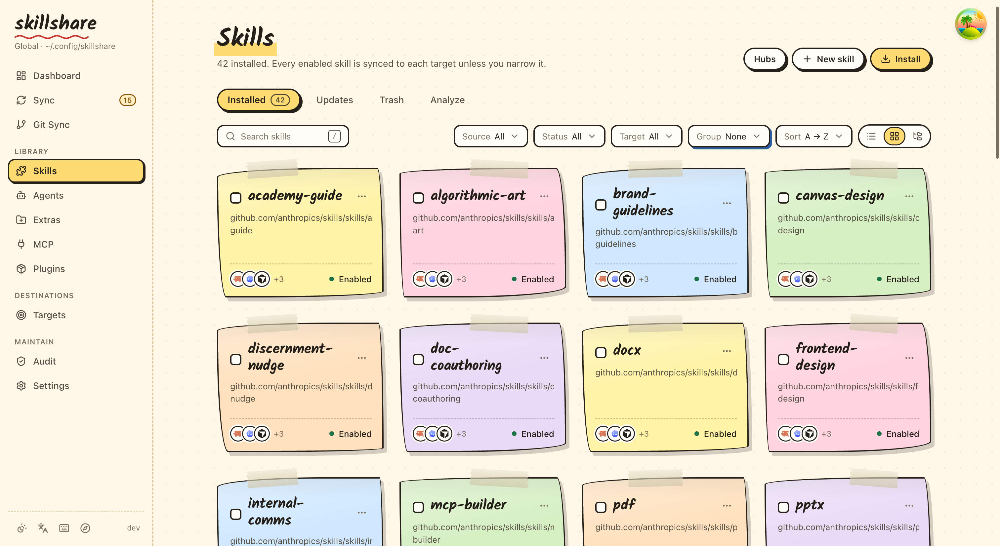

<p align="center" style="margin-bottom: 0;">
  
</p>

<h1 align="center" style="margin-top: 0.5rem; margin-bottom: 0.5rem;">skillshare</h1>

<p align="center">
  <a href="README.md">English</a> · <a href="README-de.md">Deutsch</a> · <a href="README-es.md">Español</a> · <a href="README-fr.md">Français</a> · <a href="README-ja.md">日本語</a> · <a href="README-ko.md">한국어</a> · <a href="README-pt-BR.md">Português</a> · <a href="README-zh-CN.md">简体中文</a> · <a href="README-zh-TW.md">繁體中文</a>
</p>

<p align="center">
  <a href="https://skillshare.runkids.cc"></a>
  <a href="LICENSE"></a>
  <a href="https://github.com/runkids/skillshare/releases"></a>
  <a href="https://github.com/runkids/skillshare/releases"></a>
  
  <a href="https://deepwiki.com/runkids/skillshare"></a>
</p>

<p align="center">
  <a href="https://github.com/runkids/skillshare/stargazers"></a>
</p>

<p align="center">
  <a href="https://trendshift.io/repositories/21835" target="_blank"></a>
  <a href="https://trendshift.io/repositories/21835?utm_source=trendshift-badge&amp;utm_medium=badge&amp;utm_campaign=badge-trendshift-21835" target="_blank" rel="noopener noreferrer"></a>
</p>

<p align="center">
  <strong>Votre environnement de code IA, partout.</strong><br>
  Gérez skills, agents, rules, connexions MCP et hooks au même endroit.<br>
  Pour Claude Code, Codex, Pi, OpenCode et bien d'autres.
</p>

<p align="center">
  <a href="https://skillshare.runkids.cc">Site web</a> •
  <a href="#installation">Installation</a> •
  <a href="#démarrage-rapide">Démarrage rapide</a> •
  <a href="#fonctionnalités">Fonctionnalités</a> •
  <a href="#aperçu-du-cli-et-de-lui">Captures d'écran</a> •
  <a href="#desktop-app">Application de bureau</a> •
  <a href="https://skillshare.runkids.cc/docs">Documentation</a>
</p>

<p align="center">
  
</p>

> [!NOTE]
> **Dernière version** : v0.26.4 — `update` ignore désormais les skills que vous avez modifiés depuis l'installation, et `skillshare check <name> --diff` montre vos modifications. La liste des skills du dashboard affiche les descriptions et range les paquets de skills sous leur skill parent, et vous pouvez importer plusieurs plugins installés à la fois. [Toutes les versions →](https://github.com/runkids/skillshare/releases)

## Pourquoi skillshare

Changer d'outil IA ne devrait pas obliger à reconstruire tout son environnement.
skillshare donne à vos skills et à vos autres ressources IA un emplacement que vous contrôlez.

- **Changez d'outil, gardez vos skills** — modifiez une fois, puis synchronisez vers Claude Code, Codex, Pi et les autres outils que vous utilisez.
- **Emportez votre environnement** — versionnez votre source avec Git et récupérez-la sur une autre machine.
- **Partagez avec votre équipe** — gardez les ressources du projet avec votre code et distribuez les skills partagés via des tracked repositories.

Une personne de l'équipe utilise Claude Code, une autre Codex. Gardez leur checklist de revue de code commune dans `.skillshare/`, avec le projet. Les nouveaux arrivants installent les skills déclarés et les synchronisent vers les outils configurés au lieu de copier des instructions depuis le chat. [Intégration d'équipe →](https://skillshare.runkids.cc/docs/how-to/recipes/team-onboarding-recipe)

Utilisez l'application de bureau ou le CLI pour tout gérer en local, [auditer les skills avant usage](https://skillshare.runkids.cc/docs/reference/commands/audit) et [choisir ce que reçoit chaque outil](https://skillshare.runkids.cc/docs/how-to/daily-tasks/filtering-skills).

> Vous venez d'un autre outil ? [Guide de migration](https://skillshare.runkids.cc/docs/how-to/advanced/migration) · [Comparaison](https://skillshare.runkids.cc/docs/understand/philosophy/comparison)

## Aperçu du CLI et de l'UI

| Détail d'un skill | Audit de sécurité |
|---|---|
|  |  |

| Tableau de bord web | Page Skills web |
|---|---|
|  |  |

## Installation

> [!TIP]
> **Utilisez skillshare depuis votre bureau.** [Téléchargez Skillshare App](https://github.com/runkids/skillshare-app/releases/latest) pour macOS (Apple Silicon), Windows et Linux. Au premier lancement, l'application vous aide à installer ou localiser le CLI, à choisir vos outils IA et à lancer votre première synchronisation. [Guide d'installation](https://skillshare.runkids.cc/docs/getting-started/desktop-app).

<a id="desktop-app"></a>

### Application de bureau — configuration visuelle et gestion au quotidien

[Skillshare App](https://github.com/runkids/skillshare-app) réunit skills, agents, MCP et hooks dans une fenêtre de bureau. Installez l'application, ouvrez-la et suivez la configuration du premier lancement.

macOS (Apple Silicon), avec Homebrew :

```bash
brew tap runkids/tap
brew install --cask skillshare-app
```

**Windows / Linux, ou installation manuelle sur macOS :** [Téléchargez les derniers installeurs](https://github.com/runkids/skillshare-app/releases/latest). Consultez le [guide de l'application de bureau](https://skillshare.runkids.cc/docs/getting-started/desktop-app) pour les détails propres à chaque plateforme.

### CLI : macOS / Linux

```bash
curl -fsSL https://raw.githubusercontent.com/runkids/skillshare/main/install.sh | sh
```

Le script installe par défaut dans `~/.local/bin` : les installations et mises à jour courantes n'ont pas besoin de `sudo`. Si l'installeur affiche des instructions de configuration du PATH, suivez-les avant de lancer `skillshare`. Ajoutez la ligne suggérée à la configuration de votre shell (par exemple `~/.zshrc` ou `~/.bashrc`) pour les prochains terminaux. Définissez `INSTALL_DIR` pour choisir un autre emplacement.

### Windows PowerShell

```powershell
irm https://raw.githubusercontent.com/runkids/skillshare/main/install.ps1 | iex
```

### CLI : Homebrew

```bash
brew install skillshare
```

> **Astuce :** lancez `skillshare upgrade` pour passer à la dernière version. La commande détecte votre méthode d'installation et s'occupe du reste.

### GitHub Actions

```yaml
- uses: runkids/setup-skillshare@v1
  with:
    source: ./skills
- run: skillshare sync
```

Toutes les options (audit, mode projet, version figée) sont décrites dans [`setup-skillshare`](https://github.com/marketplace/actions/setup-skillshare).

### Raccourci (facultatif)

Ajoutez un alias à la configuration de votre shell (`~/.zshrc` ou `~/.bashrc`) :

```bash
alias ss='skillshare'
```

## Démarrage rapide

```bash
skillshare init            # Crée la config, la source et les targets détectées
skillshare sync            # Synchronise les skills vers toutes les targets
```

## Fonctionnement

- macOS / Linux : `~/.config/skillshare/`
- Windows : `%AppData%\skillshare\`

```
┌─────────────────────────────────────────────────────────────┐
│                    Source Directory                         │
│   ~/.config/skillshare/skills/    ← skills (SKILL.md)       │
│   ~/.config/skillshare/agents/    ← agents                  │
│   ~/.config/skillshare/extras/    ← rules, commands, etc.   │
└─────────────────────────────────────────────────────────────┘
                              │ sync
              ┌───────────────┼───────────────┐
              ▼               ▼               ▼
       ┌───────────┐   ┌───────────┐   ┌───────────┐
       │  Claude   │   │  OpenCode │   │ OpenClaw  │   ...
       └───────────┘   └───────────┘   └───────────┘
```

| Plateforme | Source des skills | Source des agents | Source des extras | Type de lien |
|----------|---------------|---------------|---------------|-----------|
| macOS/Linux | `~/.config/skillshare/skills/` | `~/.config/skillshare/agents/` | `~/.config/skillshare/extras/` | Symlinks |
| Windows | `%AppData%\skillshare\skills\` | `%AppData%\skillshare\agents\` | `%AppData%\skillshare\extras\` | Jonctions NTFS pour les dossiers (sans droits administrateur) ; les symlinks de fichiers demandent le Developer Mode, sinon les fichiers sont copiés |

| | Impératif (une installation par commande) | Déclaratif (skillshare) |
|---|---|---|
| **Source de vérité** | Skills copiés indépendamment | Une seule source → symlinks (ou copies) |
| **Nouvelle machine** | Relancer chaque installation à la main | `git clone` de la config + `sync` |
| **Audit de sécurité** | Aucun | `audit` intégré + analyse automatique à l'installation et à la mise à jour |
| **Tableau de bord web** | Aucun | `skillshare ui` |
| **Dépendance d'exécution** | Node.js + npm | Aucune (un seul binaire Go) |

> [Comparaison complète →](https://skillshare.runkids.cc/docs/understand/philosophy/comparison)

## Fonctionnalités

**Installer et mettre à jour des skills** — depuis GitHub, GitLab ou n'importe quel hôte Git

```bash
skillshare install github.com/reponame/skills
skillshare update --all
skillshare target claude --mode copy  # si les symlinks ne fonctionnent pas
```

**Problèmes de symlinks ?** — passez en mode copy pour une target

```bash
skillshare target <name> --mode copy
skillshare sync
```

**Audit de sécurité** — analysez les skills avant qu'ils n'atteignent votre agent

```bash
skillshare audit
```

**Skills de projet** — par dépôt, commités avec votre code

```bash
skillshare init -p && skillshare sync
```

**Agents** — synchronisez vos agents personnalisés vers les targets qui les prennent en charge

```bash
skillshare sync agents            # synchronise uniquement les agents
skillshare sync --all             # synchronise skills + agents + extras + MCP + hooks ensemble
```

**Extras** — gérez rules, commands, prompts et plus

```bash
skillshare extras init rules          # crée un extra "rules"
skillshare sync --all                 # synchronise skills + agents + extras + MCP + hooks ensemble
skillshare extras collect rules       # rapatrie les fichiers locaux vers la source
```

**Connexions MCP** — configurez une fois pour Claude Code, Codex, Pi, VS Code, OpenCode et d'autres

```bash
skillshare mcp add                    # configuration guidée par URL ou JSON
skillshare sync mcp --dry-run         # aperçu des changements dans les configurations natives
skillshare sync mcp                   # applique les paramètres de connexion
```

Gardez les définitions dans `config.yaml` ou référencez un `mcp.yaml` séparé.
Voir [la configuration MCP](https://skillshare.runkids.cc/docs/how-to/daily-tasks/sharing-mcp)
pour des exemples, les références à des variables d'environnement et l'import de connexions existantes.

Gérez les hooks natifs sans les exécuter :

```bash
skillshare hooks add check --file ./check.yaml
skillshare hooks sync --dry-run
skillshare hooks sync
```

**Plugins** — installez un plugin complet et choisissez les outils qui le reçoivent

```bash
skillshare plugin add                 # guidé : source, plugin, targets, revue
skillshare plugin add owner/repo --target claude --target codex --no-tui
skillshare sync plugins --dry-run     # les plugins se synchronisent à part de sync --all
```

Les installations natives existantes peuvent être reprises avec `plugin import`.
Voir [Gérer les plugins entre outils](https://skillshare.runkids.cc/docs/how-to/daily-tasks/sharing-plugins).

**Complétion du shell** — complétez commandes, options et sous-commandes avec Tab

```bash
skillshare completion bash --install   # aussi : zsh, fish, powershell, nushell
```

**Points de sauvegarde locaux** — commitez les changements de la source sans les pousser

```bash
skillshare commit -m "Update review skill"
skillshare commit --dry-run
```

**Tableau de bord web** — un panneau de contrôle visuel

```bash
skillshare ui
```

[Toutes les commandes et guides →](https://skillshare.runkids.cc/docs/reference/commands)

## Contribuer

Les contributions sont les bienvenues ! Ouvrez d'abord une issue, puis proposez une draft PR avec des tests.
Voir [CONTRIBUTING.md](CONTRIBUTING.md) pour la mise en place.

```bash
git clone https://github.com/runkids/skillshare.git && cd skillshare
make check  # format + lint + test
```

> [!TIP]
> Vous ne savez pas par où commencer ? Parcourez les [issues ouvertes](https://github.com/runkids/skillshare/issues) ou essayez le [Playground](https://skillshare.runkids.cc/docs/learn/with-playground), un environnement de développement sans configuration.

## Contributeurs

Merci à toutes les personnes qui ont contribué à skillshare. La liste se trouve dans le [README en anglais](README.md#contributors).

---

Si skillshare vous est utile, pensez à lui donner une ⭐

## Star History

<a href="https://star-history.dera.page/runkids/skillshare">
 <picture>
   <source media="(prefers-color-scheme: dark)" srcset="https://star-history.dera.page/svg?repos=runkids/skillshare&theme=dark" />
   <source media="(prefers-color-scheme: light)" srcset="https://star-history.dera.page/svg?repos=runkids/skillshare" />
   
 </picture>
</a>

---

## Licence

MIT
