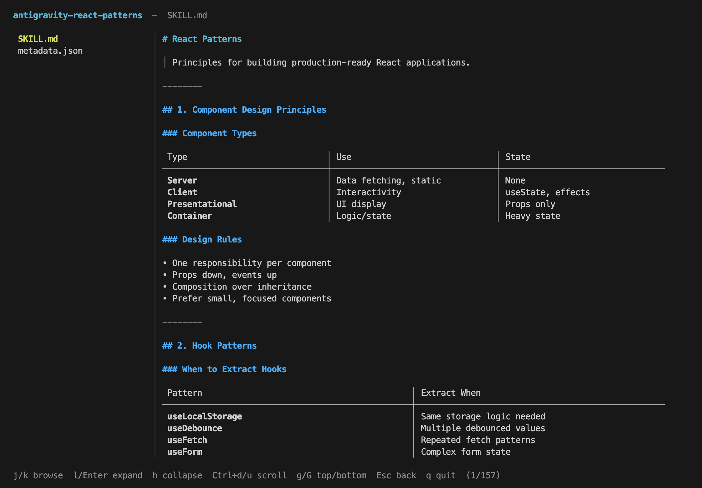
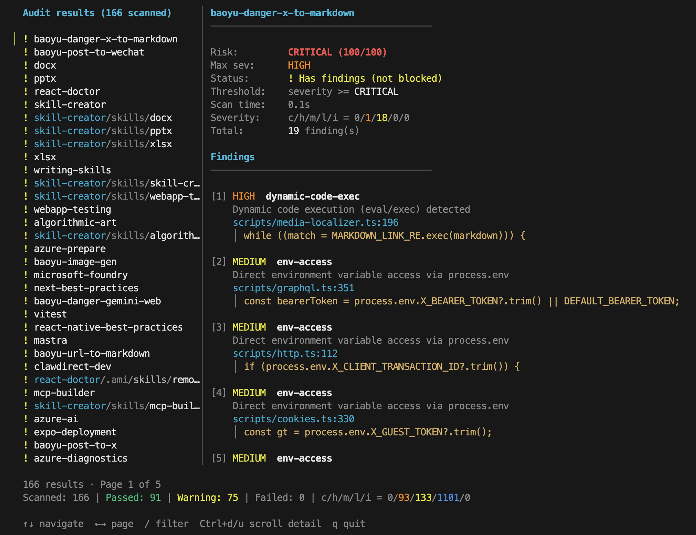
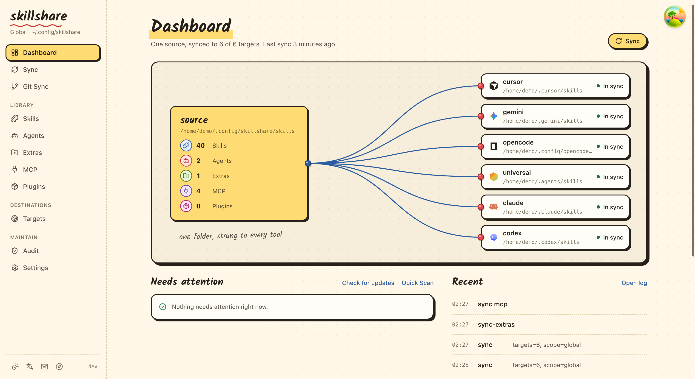
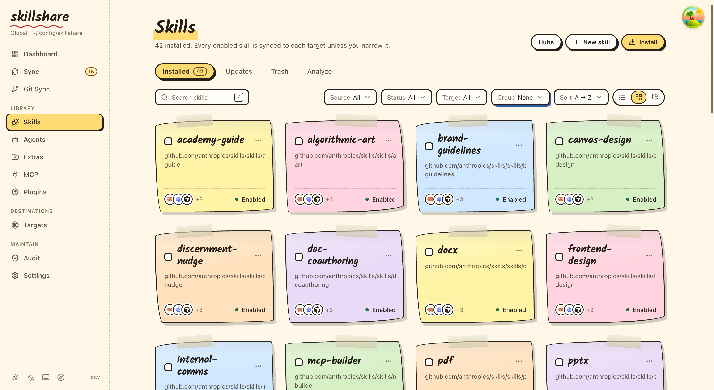

<p align="center" style="margin-bottom: 0;">
  
</p>

<h1 align="center" style="margin-top: 0.5rem; margin-bottom: 0.5rem;">skillshare</h1>

<p align="center">
  <a href="README.md">English</a> · <a href="README-de.md">Deutsch</a> · <a href="README-es.md">Español</a> · <a href="README-fr.md">Français</a> · <a href="README-ja.md">日本語</a> · <a href="README-ko.md">한국어</a> · <a href="README-pt-BR.md">Português</a> · <a href="README-tr.md">Türkçe</a> · <a href="README-zh-CN.md">简体中文</a> · <a href="README-zh-TW.md">繁體中文</a>
</p>

<p align="center">
  <a href="https://skillshare.runkids.cc"></a>
  <a href="LICENSE"></a>
  <a href="https://github.com/runkids/skillshare/releases"></a>
  <a href="https://github.com/runkids/skillshare/releases"></a>
  
  <a href="https://deepwiki.com/runkids/skillshare"></a>
  <a href="https://ko-fi.com/williehung"></a>
</p>

<p align="center">
  <a href="https://github.com/runkids/skillshare/stargazers"></a>
</p>

<p align="center">
  <a href="https://trendshift.io/repositories/21835" target="_blank"></a>
  <a href="https://trendshift.io/repositories/21835?utm_source=trendshift-badge&amp;utm_medium=badge&amp;utm_campaign=badge-trendshift-21835" target="_blank" rel="noopener noreferrer"></a>
</p>

<p align="center">
  <strong>Yapay zekâ kodlama kurulumunuz, her yerde.</strong><br>
  Becerileri, ajanları, kuralları, MCP bağlantılarını ve kancaları (hooks) tek bir yerde yönetin.<br>
  Claude Code, Codex, Pi, OpenCode ve daha fazlası için.
</p>

<p align="center">
  <a href="https://skillshare.runkids.cc">Web Sitesi</a> •
  <a href="#kurulum">Kurulum</a> •
  <a href="#hızlı-başlangıç">Hızlı Başlangıç</a> •
  <a href="#öne-çıkanlar">Öne Çıkanlar</a> •
  <a href="#screenshots">Ekran Görüntüleri</a> •
  <a href="#desktop-app">Masaüstü Uygulaması</a> •
  <a href="https://skillshare.runkids.cc/docs">Belgeler</a>
</p>

<p align="center">
  
</p>

> [!NOTE]
> **Son sürüm**: v0.34.0 — Herdr modları artık birer plugin: `herdr-app` hedefi Herdr modlarını ve başlatıcılarını kurar, günceller ve kaldırır; bir modun paneli mevcut düzeninizin bir kopyasında açılabilir ve kontrol paneli birden fazla plugin üzerinde aynı anda işlem yapar. `skillshare hooks sync NAME1 NAME2 --replace` çakışan birden fazla yerel hook'u tek seferde devralır; aynı ada sahip iki skill de artık atlanmak yerine senkronize edilir, biri tam yol adıyla. Özel tema **Glass: Everywhere**, altı yeni arka plan tonu ve yüzey seçenekleri ekler; kontrol paneli bir Agent'ın MCP dosyasını sayfada gösterebilir. [Herdr kılavuzu →](https://skillshare.runkids.cc/docs/learn/with-herdr) · [Tüm sürümler →](https://github.com/runkids/skillshare/releases)

## Neden skillshare

Yapay zekâ araçlarını değiştirmek, kurulumunuzu baştan oluşturmak anlamına gelmemelidir.
skillshare, becerilerinize ve diğer yapay zekâ kaynaklarınıza kontrol ettiğiniz bir yuva sunar.

- **Araçları değiştirin, becerilerinizi koruyun** — bir kez düzenleyin, ardından Claude Code, Codex, Pi ve kullandığınız diğer araçlarla eşitleyin.
- **Kurulumunuzu yanınızda taşıyın** — kaynağınızı Git'te sürümleyin ve başka bir makineye çekin.
- **Ekibinizle paylaşın** — proje kaynaklarını kodunuzla birlikte tutun ve paylaşılan becerileri izlenen depolar üzerinden dağıtın.

Bir ekip arkadaşınız Claude Code, diğeri Codex kullanıyor olabilir. Paylaşılan kod inceleme kontrol listenizi projenin yanında `.skillshare/` içinde tutun. Yeni ekip üyeleri sohbetten talimat kopyalamak yerine bildirilen becerileri kurar ve yapılandırılan araçlarla eşitler. [Ekip başlangıç rehberi →](https://skillshare.runkids.cc/docs/how-to/recipes/team-onboarding-recipe)

Her şeyi yerel olarak yönetmek için masaüstü uygulamasını veya CLI'ı kullanın, [kullanmadan önce becerileri denetleyin](https://skillshare.runkids.cc/docs/reference/commands/audit) ve [her aracın ne alacağını seçin](https://skillshare.runkids.cc/docs/how-to/daily-tasks/filtering-skills).

> Başka bir araçtan mı geliyorsunuz? [Geçiş Kılavuzu](https://skillshare.runkids.cc/docs/how-to/advanced/migration) · [Karşılaştırma](https://skillshare.runkids.cc/docs/understand/philosophy/comparison)

<a id="screenshots"></a>

## CLI ve Arayüz Ön İzlemesi

| Beceri Ayrıntısı | Güvenlik Denetimi |
|---|---|
|  |  |

| Web Kontrol Paneli | Web Arayüzü Becerileri |
|---|---|
|  |  |

## Kurulum

> [!TIP]
> **skillshare'i masaüstünüzden kullanın.** macOS (Apple Silicon), Windows ve Linux için [Skillshare App uygulamasını edinin](https://github.com/runkids/skillshare-app/releases/latest). İlk açılış CLI'ı kurmanıza veya bulmanıza, yapay zekâ araçlarınızı seçmenize ve ilk eşitlemenizi çalıştırmanıza yardımcı olur. [Kurulum kılavuzu](https://skillshare.runkids.cc/docs/getting-started/desktop-app).

<a id="desktop-app"></a>

### Masaüstü Uygulaması — görsel kurulum ve günlük yönetim

[Skillshare App](https://github.com/runkids/skillshare-app) becerileri, ajanları, MCP'yi ve kancaları bir masaüstü penceresinde toplar. Uygulamayı kurun, açın ve ilk açılış kurulumunu izleyin.

macOS (Apple Silicon), Homebrew ile:

```bash
brew tap runkids/tap
brew install --cask skillshare-app
```

**Windows / Linux veya manuel macOS kurulumu:** [En son uygulama yükleyicilerini indirin](https://github.com/runkids/skillshare-app/releases/latest). Platform ayrıntıları için [Masaüstü Uygulaması kılavuzuna](https://skillshare.runkids.cc/docs/getting-started/desktop-app) bakın.

### CLI: macOS / Linux

```bash
curl -fsSL https://raw.githubusercontent.com/runkids/skillshare/main/install.sh | sh
```

Betik varsayılan olarak `~/.local/bin` dizinine kurar; bu nedenle normal kurulumlar ve güncellemeler `sudo` gerektirmez. Yükleyici PATH kurulum talimatları yazdırırsa `skillshare` çalıştırmadan önce bunları uygulayın. Gelecekteki terminaller için önerilen satırı kabuk yapılandırmanıza (örneğin `~/.zshrc` veya `~/.bashrc`) ekleyin. Başka bir konum kullanmak için `INSTALL_DIR` ayarlayın.

### Windows PowerShell

```powershell
irm https://raw.githubusercontent.com/runkids/skillshare/main/install.ps1 | iex
```

### CLI: Homebrew

```bash
brew install skillshare
```

> **İpucu:** En son sürüme güncellemek için `skillshare upgrade` çalıştırın. Kurulum yönteminizi otomatik algılar ve gerisini halleder.

### CLI: Nix

```bash
nix profile add github:runkids/skillshare
```

`nix profile upgrade skillshare` ile güncelleyin. Flake'lerin etkin olduğu Nix 2.30+ gerektirir; daha eski Nix veya Lix sürümlerinde `nix profile install` kullanın. NixOS ve Home Manager yapılandırmaları flake'in `overlays.default` katmanını kullanabilir.

### CLI: PyPI

```bash
uv tool install skillshare-cli
```

Veya `pipx install skillshare-cli` ya da `pip install skillshare-cli`. skillshare'i kurmadan denemek için `uvx --from skillshare-cli skillshare` çalıştırın. `uv tool upgrade skillshare-cli` veya `pipx upgrade skillshare-cli` gibi kendi yükleyicinizle güncelleyin.

### GitHub Actions

```yaml
- uses: runkids/setup-skillshare@v1
  with:
    source: ./skills
- run: skillshare sync
```

Tüm seçenekler (denetim, proje modu, sürüm sabitleme) için [`setup-skillshare`](https://github.com/marketplace/actions/setup-skillshare) sayfasına bakın.

### Kısaltma (İsteğe Bağlı)

Kabuk yapılandırmanıza (`~/.zshrc` veya `~/.bashrc`) bir takma ad (alias) ekleyin:

```bash
alias ss='skillshare'
```

## Hızlı Başlangıç

```bash
skillshare init            # Yapılandırma, kaynak ve algılanan hedefleri oluştur
skillshare sync            # Becerileri tüm hedeflerle eşitle
```

## Nasıl Çalışır

- macOS / Linux: `~/.config/skillshare/`
- Windows: `%AppData%\skillshare\`

```
┌─────────────────────────────────────────────────────────────┐
│                    Kaynak Dizini (Source)                   │
│   ~/.config/skillshare/skills/    ← beceriler (SKILL.md)    │
│   ~/.config/skillshare/agents/    ← ajanlar                 │
│   ~/.config/skillshare/extras/    ← kurallar, komutlar vb.  │
└─────────────────────────────────────────────────────────────┘
                              │ sync
              ┌───────────────┼───────────────┐
              ▼               ▼               ▼
       ┌───────────┐   ┌───────────┐   ┌───────────┐
       │  Claude   │   │  OpenCode │   │ OpenClaw  │   ...
       └───────────┘   └───────────┘   └───────────┘
```

| Platform | Beceriler Kaynağı | Ajanlar Kaynağı | Ekstralar Kaynağı | Bağlantı Türü |
|----------|-------------------|-----------------|-------------------|---------------|
| macOS/Linux | `~/.config/skillshare/skills/` | `~/.config/skillshare/agents/` | `~/.config/skillshare/extras/` | Sembolik Bağlantılar (Symlinks) |
| Windows | `%AppData%\skillshare\skills\` | `%AppData%\skillshare\agents\` | `%AppData%\skillshare\extras\` | Klasörler için NTFS Junction (yönetici gerekmez); dosya sembolik bağlantıları Geliştirici Modu gerektirir, aksi hâlde kopyalanır |

| | Emir Kipinde (komut başına kurulum) | Bildirimsel (skillshare) |
|---|---|---|
| **Doğruluk kaynağı** | Beceriler bağımsız olarak kopyalanır | Tek kaynak → sembolik bağlantılar (veya kopyalar) |
| **Yeni makine kurulumu** | Her kurulumu manuel olarak yeniden çalıştır | `git clone` yapılandırması + `sync` |
| **Güvenlik denetimi** | Yok | Yerleşik `audit` + kurulum/güncellemede otomatik tarama |
| **Web kontrol paneli** | Yok | `skillshare ui` |
| **Çalışma zamanı bağımlılığı** | Node.js + npm | Yok (tek Go ikili dosyası) |

> [Tam karşılaştırma →](https://skillshare.runkids.cc/docs/understand/philosophy/comparison)

## Öne Çıkanlar

**Beceri kurma ve güncelleme** — GitHub, GitLab veya herhangi bir Git sunucusundan

```bash
skillshare install github.com/reponame/skills
skillshare update --all
skillshare target claude --mode copy  # sembolik bağlantılar çalışmıyorsa
```

**Sembolik bağlantı sorunları mı var?** — hedef başına kopyalama moduna geçin

```bash
skillshare target <name> --mode copy
skillshare sync
```

**Güvenlik denetimi** — beceriler ajanınıza ulaşmadan önce tarayın

```bash
skillshare audit
```

**Proje becerileri** — depo başına, kodunuzla birlikte commit edilir

```bash
skillshare init -p && skillshare sync
```

**Ajanlar** — özel ajanları ajan destekli hedeflerle eşitleyin

```bash
skillshare sync agents            # yalnızca ajanları eşitle
skillshare sync --all             # beceriler + ajanlar + ekstralar + MCP + kancaları birlikte eşitle
```

**Ekstralar** — kuralları, komutları, istemleri ve daha fazlasını yönetin

```bash
skillshare extras init rules          # "rules" adlı bir ekstra oluştur
skillshare sync --all                 # beceriler + ajanlar + ekstralar + MCP + kancaları birlikte eşitle
skillshare extras collect rules       # yerel dosyaları kaynağa geri topla
```

**MCP bağlantıları** — Claude Code, Codex, Pi, VS Code, OpenCode ve daha fazlası için bir kez yapılandırın

```bash
skillshare mcp add                    # rehberli URL veya JSON kurulumu
skillshare sync mcp --dry-run         # yerel yapılandırma değişikliklerini ön izle
skillshare sync mcp                   # bağlantı ayarlarını uygula
```

Tanımları `config.yaml` içinde tutun veya ayrı bir `mcp.yaml` dosyasına başvurun.
Örnekler, ortam değişkeni başvuruları ve mevcut bağlantıları içe aktarma için [MCP kurulumuna](https://skillshare.runkids.cc/docs/how-to/daily-tasks/sharing-mcp) bakın.

Yerel kancaları (hooks) çalıştırmadan yönetin:

```bash
skillshare hooks add check --file ./check.yaml
skillshare hooks sync --dry-run
skillshare hooks sync
```

**Eklentiler (Plugins)** — eksiksiz bir eklenti kurun ve hangi araçların alacağını seçin

```bash
skillshare plugin add                 # rehberli: kaynak, eklenti, hedefler, inceleme
skillshare plugin add owner/repo --target claude --target codex --no-tui
skillshare sync plugins --dry-run     # eklentiler sync --all komutundan ayrı eşitlenir
```

Mevcut yerel kurulumlar `plugin import` ile devralınabilir.
Bkz. [Araçlar arasında eklentileri yönetme](https://skillshare.runkids.cc/docs/how-to/daily-tasks/sharing-plugins).

**Kabuk tamamlama** — komutları, bayrakları ve alt komutları Tab ile tamamlayın

```bash
skillshare completion bash --install   # ayrıca: zsh, fish, powershell, nushell
```

**Yerel kontrol noktaları** — göndermeden (push) kaynak değişikliklerini commit edin

```bash
skillshare commit -m "Update review skill"
skillshare commit --dry-run
```

**Web kontrol paneli** — görsel kontrol paneli

```bash
skillshare ui
```

**Herdr paneli** — [Herdr](https://herdr.dev) içinde ajanlarınızın yanında skillshare: güncellemeler, eşitleme, denetlenmiş kurulumlar ve kaynak depo tek panelde

[Herdr panelini kurun →](https://skillshare.runkids.cc/docs/learn/with-herdr)

[Tüm komutlar ve kılavuzlar →](https://skillshare.runkids.cc/docs/reference/commands)

## Katkıda Bulunma

Katkılarınız memnuniyetle karşılanır! Önce bir issue açın, ardından testlerle birlikte bir taslak PR gönderin.
Kurulum ayrıntıları için [CONTRIBUTING.md](CONTRIBUTING.md) dosyasına bakın.

```bash
git clone https://github.com/runkids/skillshare.git && cd skillshare
make check  # biçimlendirme + lint + test
```

> [!TIP]
> Nereden başlayacağınızdan emin değil misiniz? [Açık issue'lara](https://github.com/runkids/skillshare/issues) göz atın veya kurulum gerektirmeyen geliştirme ortamı için [Playground](https://skillshare.runkids.cc/docs/learn/with-playground) deneyin.

## Katkıda Bulunanlar

[GitHub'da katkıda bulunanları görüntüleyin](https://github.com/runkids/skillshare/graphs/contributors)

### Topluluk teşekkürleri

Hata bildiren, iyileştirme öneren veya bir düzeltmeyi test etmeye yardımcı olan herkese teşekkürler.

<a href="https://github.com/leeeezx"></a>
<a href="https://github.com/Vergil333"></a>
<a href="https://github.com/romanr"></a>
<a href="https://github.com/xocasdashdash"></a>
<a href="https://github.com/philippe-granet"></a>
<a href="https://github.com/terranc"></a>
<a href="https://github.com/benrfairless"></a>
<a href="https://github.com/nerveband"></a>
<a href="https://github.com/EarthChen"></a>
<a href="https://github.com/gdm257"></a>
<a href="https://github.com/skovtunenko"></a>
<a href="https://github.com/TyceHerrman"></a>
<a href="https://github.com/1am2syman"></a>
<a href="https://github.com/thealokkr"></a>
<a href="https://github.com/JasonLandbridge"></a>
<a href="https://github.com/masonc15"></a>
<a href="https://github.com/richardwhatever"></a>
<a href="https://github.com/reneleonhardt"></a>
<a href="https://github.com/ndeybach"></a>
<a href="https://github.com/hhh2210"></a>
<a href="https://github.com/leoarry"></a>
<a href="https://github.com/salmonumbrella"></a>
<a href="https://github.com/daylamtayari"></a>
<a href="https://github.com/dstotijn"></a>
<a href="https://github.com/ipruning"></a>
<a href="https://github.com/massukio"></a>
<a href="https://github.com/nathanvale"></a>
<a href="https://github.com/LloydPowell771"></a>
<a href="https://github.com/kevincobain2000"></a>
<a href="https://github.com/StephenPAdams"></a>
<a href="https://github.com/mk-imagine"></a>
<a href="https://github.com/Curtion"></a>
<a href="https://github.com/amdoi7"></a>
<a href="https://github.com/jessica-engel"></a>
<a href="https://github.com/AlimuratYusup"></a>
<a href="https://github.com/thor-shuang"></a>
<a href="https://github.com/bishopmatthew"></a>
<a href="https://github.com/chaosky"></a>
<a href="https://github.com/iFwu"></a>
<a href="https://github.com/ildunari"></a>
<a href="https://github.com/vieGPT"></a>
<a href="https://github.com/aestilog"></a>
<a href="https://github.com/xarthurx"></a>
<a href="https://github.com/m0cun"></a>
<a href="https://github.com/bit3125"></a>
<a href="https://github.com/eekryuos"></a>
<a href="https://github.com/Bongseop-Kim"></a>
<a href="https://github.com/sophodex"></a>
<a href="https://github.com/PeterTianbuhan"></a>
<a href="https://github.com/dotned"></a>
<a href="https://github.com/ismferd"></a>
<a href="https://github.com/jblackburn21"></a>
<a href="https://github.com/jnhu76"></a>
<a href="https://github.com/jacobleft"></a>
<a href="https://github.com/rhysmcneill"></a>
<a href="https://github.com/druellan"></a>
<a href="https://github.com/12britz"></a>
<a href="https://github.com/askpatrickw"></a>
<a href="https://github.com/Almost42"></a>
<a href="https://github.com/Brett-Best"></a>
<a href="https://github.com/isCopyman"></a>
<a href="https://github.com/svob"></a>
<a href="https://github.com/michal-grzelak"></a>
<a href="https://github.com/shikbupt"></a>
<a href="https://github.com/LeoYeAI"></a>
<a href="https://github.com/TIR44"></a>
<a href="https://github.com/Ajaymamtora"></a>
<a href="https://github.com/vishaldialpad"></a>
<a href="https://github.com/kankan0829"></a>
<a href="https://github.com/dnabb"></a>
<a href="https://github.com/thinhngotony"></a>
<a href="https://github.com/skaurus"></a>
<a href="https://github.com/jamesbraza"></a>
<a href="https://github.com/2BAB"></a>
<a href="https://github.com/zdlldz"></a>
<a href="https://github.com/elstiaan"></a>
<a href="https://github.com/FaintFlower"></a>
<a href="https://github.com/yantinglin21"></a>
<a href="https://github.com/chung1912"></a>
<a href="https://github.com/r-fynn"></a>
<a href="https://github.com/cescox"></a>
<a href="https://github.com/hhdebb"></a>
<a href="https://github.com/Snurppa"></a>
<a href="https://github.com/s0undt3ch"></a>
<a href="https://github.com/danscheer"></a>
<a href="https://github.com/7zq12lvm-b"></a>
<a href="https://github.com/DarkiT"></a>
<a href="https://github.com/harisonw"></a>
<a href="https://github.com/wuhaoyujerry"></a>
<a href="https://github.com/star-nebula"></a>
<a href="https://github.com/AdamMagued"></a>
<a href="https://github.com/mbury"></a>
<a href="https://github.com/483218131"></a>
<a href="https://github.com/neilforest7"></a>
<a href="https://github.com/johnkattenhorn"></a>
<a href="https://github.com/aleps001"></a>
<a href="https://github.com/jskswamy"></a>
<a href="https://github.com/heyAidy"></a>
<a href="https://github.com/trojanwk"></a>
<a href="https://github.com/charitarthchugh"></a>
<a href="https://github.com/servaasvdc"></a>
<a href="https://github.com/tomerzcod7"></a>
<a href="https://github.com/ErykJakubik"></a>
<a href="https://github.com/maciejniec"></a>
<a href="https://github.com/jani-nieminen-framehaus"></a>
<a href="https://github.com/endgame302"></a>
<a href="https://github.com/eirikc"></a>
<a href="https://github.com/AlexisSerneels"></a>
<a href="https://github.com/digitalflex-io"></a>
<a href="https://github.com/WslzGmzs"></a>
<a href="https://github.com/NieZhuZhu"></a>
<a href="https://github.com/vivekkushalch"></a>
<a href="https://github.com/raphaelbahat"></a>
<a href="https://github.com/dev-seahouse"></a>
<a href="https://github.com/cazador481"></a>
<a href="https://github.com/SaladDay"></a>

---

## skillshare'e Destek Olun ❤️

skillshare ücretsiz ve açık kaynaklıdır.

skillshare size zaman kazandırıyorsa bana bir kahve ısmarlamayı düşünebilirsiniz.
Her katkı sürekli geliştirmeye, platformlar arası testlere,
dokümantasyona ve bakıma yardımcı olur.

[☕ Bana bir kahve ısmarlayın](https://ko-fi.com/williehung)

GitHub'da skillshare'e ⭐ vererek de yardımcı olabilirsiniz!

## Yıldız Geçmişi

<a href="https://star-history.dera.page/runkids/skillshare">
 <picture>
   <source media="(prefers-color-scheme: dark)" srcset="https://star-history.dera.page/svg?repos=runkids/skillshare&theme=dark" />
   <source media="(prefers-color-scheme: light)" srcset="https://star-history.dera.page/svg?repos=runkids/skillshare" />
   
 </picture>
</a>

---

## Lisans

MIT
