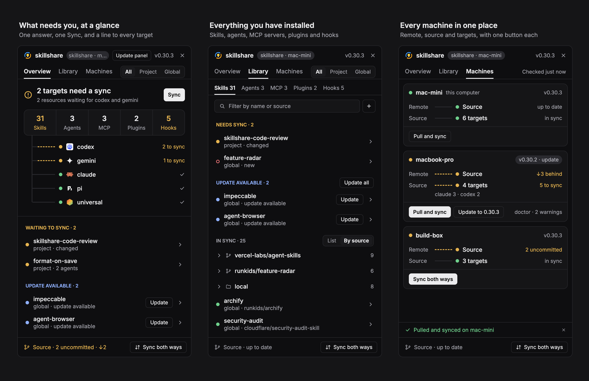

# Skillshare for Herdr

Install the Skillshare panel from a GitHub link and manage it alongside your other
Herdr mods and launchers. The panel brings sync status, updates, and your Skillshare
library into the Herdr window.

## Install and open the panel

Use a Skillshare build with `herdr-app` plugin support, and leave Herdr open on the
same computer as the Dashboard.

1. Open **Plugins → Add plugin** in the global Skillshare Dashboard.
2. Paste the [Skillshare mod package URL](https://github.com/runkids/skillshare/tree/main/herdr/skillshare-mod)
   and choose **Find plugins**.
3. Keep **Show the Skillshare panel in Herdr** selected and choose **Preview changes**.
   Review the layout name and apply. Skillshare adds a tab-bar button and a panel to a
   personal copy of your current layout, then switches to that copy. Your original
   layout stays available.

For a layout without a standard tab bar and workspace, use the
[manual placement recipe](skillshare-mod/RECIPE.md#add-to-the-existing-window).
The [complete layout package](skillshare/README.md) is separate and is not required.

## Manage it from Skillshare

Use **Plugins** to check for updates and apply them instead of using the panel's own
update button. To pause the mod, deselect **Herdr app** and sync: this uninstalls the
mod but keeps its declaration and layout copy. If the copy is active, the window
switches to the original so the panel disappears. When you select **Herdr app**
and sync again, the panel returns if the window is still on that original layout.

To remove it permanently, choose **Remove** and review the changes. Skillshare also
removes the unchanged layout copies it recorded, switching back to the original if
necessary. Edited, manually created, and unrecorded layouts are kept.

Other Herdr mods and launchers use the same plugin manager. Paste the mod package's
GitHub folder or `main.js` link. For a launcher, select **Herdr launcher** and enter
its executable path. See the [Herdr app plugin reference](../website/docs/reference/commands/plugin.md#herdr-app).
