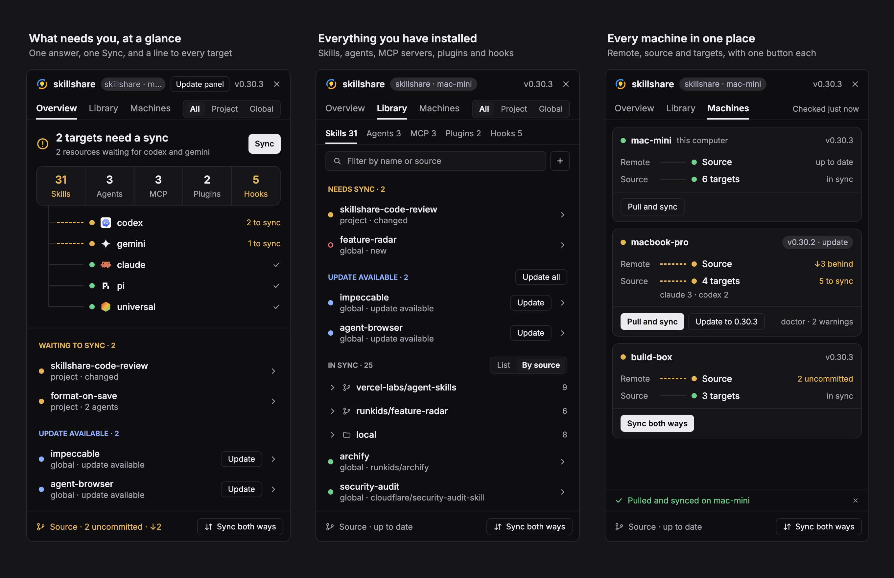

# skillshare

A skillshare button and panel added to your existing Herdr window. See which skills, agents, MCP servers, plugins and hooks need an update or a sync in the focused project's source and your global source. Preview, install with an audit first, update, sync, enable or disable, uninstall, hand an audit to an agent, sync the source repository and check every machine. Your status bar, usage meters, sidebar, theme and other panels stay as they are.



## What you see

- A 118px **skillshare** button beside the existing tab bar. It uses the 16px skillshare mark and the selected background while the panel is open.
- A 400px panel beside the work area, resizable from 380 to 720px. Its 44px header shows the folder, machine, CLI version, Update panel when available and a close button.
- **Overview**, **Library** and **Machines** tabs. In a project, All · Project · Global selects the scope; outside one, Global is shown.
- Overview answers with Everything is in sync, targets/resources waiting, or Syncing. A Sync button handles pending work. Five counts open Library by kind; up to six target lines show what waits. Hovering a collapsed count opens the remaining target lines.
- Library has kind tabs, a filter, Sync and Install. Its scrollable list groups unknown, needs-attention, needs-sync, update, in-sync and disabled rows. In-sync skills and agents fold by source, with a List switch. Each row opens a preview; update rows also have Update.
- Machines shows one card per Herdr machine: version, remote/source/target state, doctor warnings and Pull and sync or Sync both ways. A newer CLI version offers Update.
- A 34px notice line appears during work or after an outcome. A 40px footer shows the source repository state and opens its actions.
- Previews use Document/Settings/About, Targets and Details tabs where applicable. Install, audit results, source actions, conflict resolution, enable/disable, uninstall and updates use confirmation overlays.
- Herdr theme tokens and fonts, with native pressed states, loading placeholders and short transitions; no window-wide look of its own.

## How it behaves

- The button toggles the panel and the close button hides it. Open/closed state survives space switches and restarts.
- The panel follows the shown space's machine and focused terminal's folder. `.skillshare/config.yaml` or `skillshare/config.yaml` enables project scope beside global scope.
- It refreshes every 20 seconds while shown, checks resource updates every 10 minutes and checks the latest published panel release hourly. Hidden panels do no work. Resource reads appear independently; pending or failed reads remain unconfirmed instead of claiming everything is in sync.
- Sync applies pending scopes and plugin changes. Hook conflicts block all resource sync until resolved. Hook notices do not inflate named-entry counts.
- Preview reads skill/agent files or MCP settings, hiding secret values. Skills and agents offer Update, Diff, Enable/Disable, Uninstall and Ask agent to audit; declared hooks offer Enable, Disable and Remove. Destructive actions and audit hand-offs ask first.
- Install takes a repository URL, uses the CLI's dry-run plan to choose skills, audits a separate clone and installs only after a passing audit or explicit Install anyway confirmation. A failed command remains a failure even when some items were installed.
- Source actions offer Pull, Commit and push and Sync both ways. Conflicting files show both versions for a per-file choice; skill metadata merges per entry.
- Requests show their intended outcomes while pending, then reconcile with CLI reads. Errors restore the last known rows. Work is serialized per machine; different machines can run independently.
- Update panel replaces only this mod's files and saves the previous files in `.bak-update-<version>`. It leaves every layout and unrelated mod untouched.

## Built from

This is a standalone mod share folder: `mods/skillshare/`, this recipe and `preview.png`. It contains no `layouts/`. The optional complete window is a separate [layout package](../skillshare/README.md).

### Add to the existing window

1. Read `~/.config/herdr-app/AGENTS.md` and every mod file first. Tell the person that the panel runs programs, reaches GitHub and resource repositories, and reads source files outside its own folder.
2. Copy `mods/skillshare/` into Herdr's home. If it already holds this panel, update that installation instead of installing a duplicate. For an unrelated name collision, follow Herdr's rename procedure; a renamed panel must be updated by hand.
3. Inspect the shown layout. Clone it first if it is Herdr-shipped; otherwise keep the user's layout name and edit only the two skillshare nodes. Preserve every unrelated node and property, especially custom status bars and CLI usage meters.
4. Add this block beside the existing tab bar (wrap the tab block in a row only if necessary; keep its existing properties):

   ```json
   { "id": "skillshare-toggle", "type": "block", "content": { "mod": "skillshare", "props": { "role": "toggle" } }, "size": { "px": 118 } }
   ```

5. Add this column beside the work area, outside the per-space Files/Changes `panel` stack:

   ```json
   { "id": "skillshare-panel", "type": "column", "children": [{ "id": "skillshare", "type": "block", "content": { "mod": "skillshare" } }], "size": { "px": 400 }, "min": 380, "max": 720 }
   ```

   Reuse these nodes when they already belong to skillshare; do not append duplicates. If an ID belongs to something else, ask before changing it. The toggle and close button require `skillshare-panel` as the panel node ID.
6. Check the mod with `herdr-app check` and try it in the app. Keep the current layout selected unless a shipped layout had to be cloned. No key bindings are required.

### Modules and dependencies

- `main.js` imports `gpui-kit`, `gpui-base` and `herdr`. Its default role draws the panel; `toggle` draws the button. Dialog roles include `install`, `uninstall`, `audit`, `source`, `syncboth`, `conflict`, `upgrade`, `panelupdate`, `text`, `hook` and `able`.
- `model.js` parses CLI output and holds shell scripts; `jobs.js` runs detached work; `channel.js` carries requests, locks and notices; `operations.js` runs mutations; `loader.js` reads resources, checks and previews. `version.js` records the release. `mark.svg` and `icons/` supply the art.
- Herdr APIs: `exec`, `readTextFile`, `spaces`, `focused`, `machines`, `agents`, `knownAgents`, `layout`, `shared`, `setShared`, `settings`, `theme`, `props`, `openOverlay`, `closeOverlay`, `nextCommand`, `run` and `hc`. Commands: `layout.toggle`, `layout.hide` and `agent.focus`; `hc send` hands off audits.
- Programs: `skillshare`, `git`, `curl`, `sh` and standard filesystem/process tools. skillshare must be installed on every connected machine in `~/.local/bin`, `~/go/bin`, `/opt/homebrew/bin` or `/usr/local/bin`.
- Long work uses detached jobs and polled temp files. Preview reads up to 40 file names and 60 kB per file. MCP env/header/token values are redacted.
- Panel updates fetch `herdr/skillshare/mods/skillshare` from the latest published release. Both installation options use that same updater and version. The standalone files are generated from that source with `python3 scripts/herdr/package-mod.py`.

## Watch out

- **Update the mod, not the window.** For an agent-assisted update, back up the installed mod, then replace only its files. Preserve all layouts, settings, keys, other mods and layout state. If new skillshare nodes are needed, merge only those nodes into the existing layout. A request to update the panel is not a request to reinstall or switch to the complete layout.
- Keep the panel outside the per-space `panel` stack; otherwise switching spaces restores that stack and closes it.
- Renaming the mod requires rewriting its own asset/overlay paths too. The built-in updater checks the canonical `mods/skillshare` destination and refuses a renamed installation.
- Herdr ends an exec's process group and enforces a 30-second timeout. Detached jobs must drop `HC_SCOPE`, get their own process group, and report when killed rather than waiting indefinitely.
- Avoid `setShared` or `notify` during render. Do not retain `cx` beyond its callback. QuickJS rejects unparenthesized mixing of `??` and `||`/`&&`.
- Updating files reloads the mod. Copy dependencies before `main.js` and `version.js` last; the reloaded build reports the outcome through shared state. Changes to mod code are backed up, not merged into a new release.

## Done when

- `herdr-app check ~/.config/herdr-app/mods/skillshare` passes and Herdr reports no layout/mod errors.
- The existing window still has its original sidebar, status bar, usage meters, theme, panels and keys. Only the skillshare toggle and column were added.
- The toggle and close button work; switching spaces preserves open/closed state. Repeating installation does not duplicate nodes.
- Global and project scopes, previews, audit-before-install, per-machine work and source conflicts behave as described above.
- A panel update changes the mod version, keeps a backup and leaves custom layouts and unrelated mods byte-for-byte unchanged.
