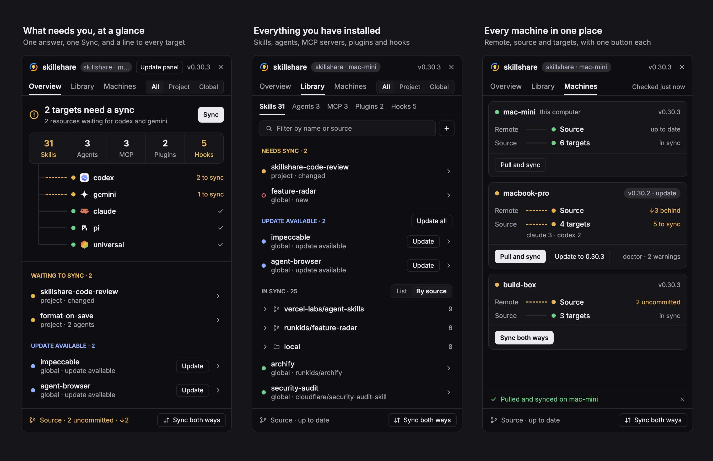
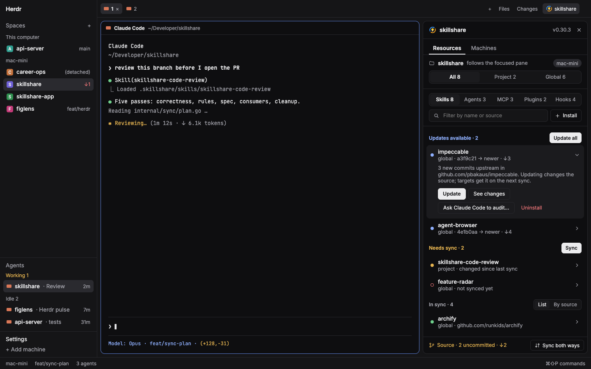

# skillshare for Herdr



[skillshare](../../README.md) keeps your skills, agents, MCP servers, plugins and hooks in one
source you control and syncs them to Claude Code, Codex, Gemini CLI and the other AI coding tools
you use. This panel puts it beside your agents in [Herdr](https://herdr.dev):

- **See what needs you.** Overview answers in one line, with one Sync button, a count of everything
  in the source and a line to every target that shows which ones are waiting.
- **Read before you act.** Click any row to preview it: a skill's `SKILL.md` and files, an agent, an
  MCP server's settings with secret values hidden, a hook, a plugin, and the targets each goes to.
- **Fix it without leaving Herdr.** Update, sync, enable or disable, uninstall, or install from a URL; every install
  is audited first, and a blocked one shows its findings before anything is written.
- **Ask your agent.** Hand an audit of any skill to the focused agent.
- **Every machine.** The Machines tab shows each Herdr machine's version, its remote, source and
  targets, with Pull and sync, or Sync both ways when that machine has work of its own.
- **The source repository.** Pull, push or sync both ways, and pick a version per file when both
  sides changed it.

New to skillshare? Start with the [main README](../../README.md) or the
[docs](https://skillshare.runkids.cc/docs/learn/with-herdr). If the panel saves you time, a star on
[runkids/skillshare](https://github.com/runkids/skillshare) helps other people find it.



## Install

From [Herdr layouts](https://herdr.dev/layouts/runkids/skillshare--herdr--skillshare/), paste this prompt into an agent in Herdr:

```text
Read ~/.config/herdr-app/AGENTS.md, then add this layout: herdr.dev/layouts/runkids/skillshare--herdr--skillshare
```

By hand:

1. Copy `mods/skillshare/` to `~/.config/herdr-app/mods/skillshare/`.
2. Copy `layouts/herdr-skillshare.json` and `layouts/herdr-skillshare.png` to
   `~/.config/herdr-app/layouts/` and switch to it (`layout.switch {name: "herdr-skillshare"}`).
   `RECIPE.md` describes it in full and `preview.png` shows it. Or, in your own layout, add:
   - a toggle block to the tab bar row:
     `{ "id": "skillshare-toggle", "type": "block", "content": { "mod": "skillshare", "props": { "role": "toggle" } }, "size": { "px": 118 } }`
   - a column beside the work area:
     `{ "id": "skillshare-panel", "type": "column", "children": [{ "id": "skillshare", "type": "block", "content": { "mod": "skillshare" } }], "size": { "px": 400 }, "min": 380, "max": 720 }`
3. Run `herdr-app check ~/.config/herdr-app/mods/skillshare`.

The panel lives in its own layout node instead of the per-space `panel` stack. Herdr's tabs mod
restores that stack per space, so a panel there closes when you switch spaces. This node's
shown or hidden state is a layout click, which Herdr keeps across spaces and restarts.

## Update

When a newer skillshare release is published, the panel's header shows **Update panel**. It asks
first, then replaces the files in `~/.config/herdr-app/mods/skillshare/` with the ones that release
ships, and Herdr reloads the panel. The files it replaced are kept in that folder's
`.bak-update-<version>`; changes you made to them are not carried over. The layout is not touched.

A panel installed before this button existed has no update check. Update it once by hand: copy
`mods/skillshare/` from the latest release over `~/.config/herdr-app/mods/skillshare/`, or paste this prompt into an
agent in Herdr:

```text
Read ~/.config/herdr-app/AGENTS.md, then replace the files in mods/skillshare with the ones in herdr/skillshare/mods/skillshare of the latest release of https://github.com/runkids/skillshare (the tag that /releases/latest lands on), overwriting the mod that is there.
```

## How it reads

- It runs on the shown space's machine (`exec` with `on`), in the focused terminal's folder.
- A folder with `.skillshare/config.yaml` or `skillshare/config.yaml` is a project; both
  scopes show and the All · Project · Global switch appears beside the tabs.
- Per scope, one detached script runs `list --all`, `diff`, `mcp list`, `plugin list` and `hooks list`
  with `--json`. `check` and `check agents` run every 10 minutes. Git state comes from `git status` in the
  source repository, because the CLI has no JSON for it.
- The install dialog reads canonical names and repository-relative paths from
  `skillshare install <source> --dry-run --json --kind skill` (`planned`), so its pick list
  follows the CLI's discovery and ignore rules. Older CLIs without `planned` must be
  upgraded on that machine before installing through the panel. Ambiguous names are refused.
  A separate shallow clone is kept for `skillshare audit <path> --json`, so a block shows
  findings before anything is written; "Install anyway" runs the install with `--force`.
  Any non-zero install exit is shown as a failure, even when an older CLI omits `error`.
  Preview, audit and install fetch separately; a moving upstream branch can change between them.
- The panel's version is `mods/skillshare/version.js`, the skillshare release it shipped with.
  Once an hour while shown, the panel asks where `github.com/runkids/skillshare/releases/latest`
  lands (`curl`, on this computer) and offers the update when that release is newer. The update
  clones only the mod's folder at that release's tag.
- The source dialog runs `skillshare pull` and `skillshare push -m`. When a pull or
  `push --pull` stops on files both sides changed, the panel reads both versions with
  `git show HEAD:<file>` and `git show @{u}:<file>`, puts the repository back, and asks
  which version to keep for each file.

- A preview reads on the item's machine: a skill's file names (40 at most) and the first 60 kB of
  the file shown, an agent's `.md`, or the MCP source file. Env, header and bearer-token values are
  replaced before the dialog gets them, so it shows names only.
- The map's target names come from `status --json` and `diff --json`. A target's count is what
  `diff` reports for skills and agents, plus each MCP server, plugin or hook that waits on it.

Overview lists only what needs you: what waits for a sync, what has an update, hook notices, and
machines that are behind once the Machines tab has read them. Library lists everything by kind,
in Need a look, Needs sync, Update available, In sync and Off; disabled rows are always under Off.
For skills and agents, In sync switches between List and By source (the default), which folds
rows from the same repository, or local ones, into collapsible groups. A source with one row stays
a plain row, and a filter opens every group.

Hook rows name their agents or planned changes, and their preview shows the description, agents
and native files. Top-level declared hooks offer confirmed Enable, Disable and Remove actions;
Sync applies them through `sync --all`. Counts include named hook entries and pending named
cleanup, excluding diagnostic notices, which get rows of their own. When a preview of the plan
fails, named entries stay listed as “sync status unknown”; they do not count as pending or in
sync. Hook conflicts block `sync --all` for every resource kind; resolve them with the CLI or
dashboard, then Sync again.

## Tests

`make test-herdr` (`node --test herdr/tests/*.test.mjs`) covers `model.js`, `jobs.js`,
`channel.js`, `operations.js` and `loader.js`, which have no Herdr imports. It runs in `make check` and CI. Check `main.js` with `herdr-app check`.
