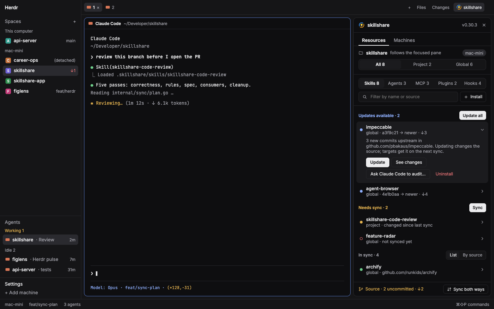

# Herdr + skillshare

Herdr's default window with a skillshare button in the tab bar and a skillshare panel beside the work area. The panel shows what the focused space's project and your global skillshare source hold: which skills, agents, MCP servers, plugins and hooks need an update or a sync. From the panel you can update, sync, install from a URL, uninstall, ask the focused agent to audit something, and sync the source repository both ways.

## What you see

Left to right, everything as in Herdr's `main` layout, plus two blocks:

- **Sidebar**, 268px: Herdr's own brand bar, Spaces, Agents and footer.
- **Work column**: the tab bar row, now `tabs` (weight 1) beside a 118px `skillshare-toggle` block. The toggle draws the 16px skillshare mark and "skillshare", on `selected` while the panel shows. Under it the shown tab and Herdr's Files/Changes side panel, then the status bar.
- **skillshare panel**, a 400px column (320–720px) right of the work area, top to bottom:
  - a 42px header: the mark, "skillshare", the CLI version in `muted`, and a close button;
  - Resources and Machines tabs, the shown one underlined in `foreground`;
  - Resources:
    - the project card: a folder icon, the folder name, "follows the focused pane" and the machine as a pill; outside a project, "Global" and "<folder> is not a skillshare project";
    - in a skillshare project, an All · Project · Global switch with counts for the selected kind;
    - a Skills · Agents · MCP · Plugins · Hooks switch with counts (named hook entries, including pending cleanup; notices do not count);
    - a filter field and an Install button;
    - the list, the only part that scrolls, in three groups:
      - "Updates available · n" in `accent`, with Update all;
      - "Needs sync · n" in `blocked`, with Sync, or Sync project / Sync global when only one scope needs it;
      - "In sync · n" in `muted`, with a quiet Show disabled · n / Hide disabled · n toggle when the list has disabled rows. Disabled rows are hidden by default and the choice is kept in `shared`; disabled hooks with pending changes stay listed. For skills and agents it also has a List · By source switch, By source by default and kept in `shared`: rows sharing a repository (a tracked repo, or host/owner/repo of the source URL, with github.com left out) or the local source fold under a collapsed row with a chevron, a `git` or `folder` icon, the source and a count. Their rows are indented 16px; a source with one row stays a plain row. A filter opens every group.
    - Each row is 48px: a dot (filled `accent`, `blocked` or `ansi2`; hollow `ansi1` when never synced or `muted` when disabled), the name, one line of detail (hook rows name their agents or planned changes), and a chevron. A row opens in place on `raised`.
    - Hook rows expand to show agents, description, full root, planned changes and inactive reasons. Nested rows also show their full root before the status line; inactive rows use a warning dot even when native files are in sync. Nested-root and cleanup-only rows are read-only.
    - Hook notices appear once above the counted groups, follow the same filters, and show unnamed changes, plan warnings and preview failures even with zero entries. Unnamed native writes offer “Native hook files need sync”; warnings and conflicts are not pending native writes. If preview fails, named rows remain above the groups with “sync status unknown”, alongside the single scope error notice. Disabled rows retain their disabled label with diagnostics; pending summaries omit unchanged targets, which remain in details.
  - Machines: one card per Herdr machine, with its version, its source repository state, doctor errors and warnings when there are any, a Pull and sync button, and "Update to …" when a newer skillshare exists.
  - a 34px status line while work runs (work, installs included, runs one at a time per machine; machines run side by side), with a spinning ring in `working`, or a notice: a done notice fades after 4 s, a warning or error stays until closed, and a stopped pull keeps a "Review conflicts" bar;
  - a 40px footer: the source state, such as "Source · n uncommitted · ↑n ↓n", "up to date" or "no remote" (`blocked` when it needs attention), and Sync both ways when the repository has an upstream.
- Dialogs open as Herdr overlays: install, uninstall, audit hand-off, source repository, sync both ways, pull conflicts, update skillshare, command output.

## How it behaves

- The panel follows the space the window shows. It runs the CLI on that space's machine, in the focused terminal's folder or the space's folder. A folder with `.skillshare/config.yaml` or `skillshare/config.yaml` is a project. It refreshes every 20 s while shown and runs `skillshare check` every 10 minutes. It does no work while hidden.
- The toggle and the close button run `layout.toggle` / `layout.hide {id: "skillshare-panel"}`. The node's hidden state is a layout click, so the panel stays open or closed across space switches and restarts.
- Clicking a row opens it:
  - skills and agents that have an update offer Update, and skills also See changes;
  - skills and agents that need a sync offer Diff;
  - skills and agents offer Uninstall, and "Ask <agent> to audit…" when Herdr knows an agent: the one focused, or the last one focused;
  - MCP and plugin rows show their state and pending targets, with no actions; Sync handles them. An opened plugin row lists its source, version and targets; an opened MCP row its targets.
- Hook conflicts block `sync --all` for every resource kind; resolve them in the CLI or dashboard before retrying.
- Sync syncs the shown scope. With All, it syncs every scope that has work in the shown kind. On the Plugins tab it also runs `sync plugins`.
- Install opens a URL dialog with recent sources:
  - a repository with several skills shows a pick list, marking the ones that would replace an installed skill;
  - a progress view then runs Download (a shallow clone), Audit (`skillshare audit <path> --json` on the clone) and Install;
  - a blocked audit stops before anything is written and shows its findings, with "Ask <agent> to review…", Cancel and Install anyway (`--force`).
- The source dialog lists uncommitted files and offers:
  - Sync both ways…;
  - Pull, which stays disabled while there are uncommitted changes or nothing to pull;
  - Commit and push with a commit message field when files are uncommitted, or Push n commits when only commits are waiting.
- When a pull stops on files both machines changed, the conflict dialog shows each file's two versions with the differing lines marked. You keep one version per file and then apply. `.metadata.json` merges per entry the way skillshare's own pull does, so only real files ask.
- Hook changes (Enable, Disable and Remove), Uninstall, the audit hand-off, conflict choices and updating skillshare itself each ask first. Sync applies hook changes through `sync --all`.

## Built from

- `layouts/herdr-skillshare.json`: a `layout.clone` of `main` (Herdr 0.1.12, `cloned_from` recorded) with two changes:
  - the tab bar block becomes `{ "id": "tabs-row", "type": "row", "size": { "px": 42 }, "resizable": false, "children": [ the tabs block with "size": { "weight": 1 }, { "id": "skillshare-toggle", "type": "block", "content": { "mod": "skillshare", "props": { "role": "toggle" } }, "size": { "px": 118 } } ] }`;
  - `work-body` gains `{ "id": "skillshare-panel", "type": "column", "size": { "px": 400 }, "min": 320, "max": 720, "children": [{ "id": "skillshare", "type": "block", "content": { "mod": "skillshare" } }] }`.
  - Root `"preview": "layouts/herdr-skillshare.png"` is the picture Settings shows.
- `mods/skillshare/`:
  - `main.js` holds the panel and its roles (`props.role`): the panel by default, `toggle`, and the dialogs.
  - `model.js` holds the parsing and the shell scripts, with no Herdr imports.
  - `jobs.js` runs skillshare: short reads as one `exec`, longer work detached and polled.
  - `channel.js` passes requests from dialogs to the panel through `shared`, with one lock per machine and the notice line.
  - `operations.js` holds the commands each request runs and the conflict handling of a pull.
  - `loader.js` reads the Resources tab's data and the Machines cards.
  - `mark.svg` is the 16px mark, and `icons/` holds the stroke icons.
- Herdr functions:
  - `exec` with `on`;
  - `readTextFile`;
  - `spaces`, `focused`, `machines`, `agents`, `layout`;
  - `shared` / `setShared`, `settings`, `theme`, `props`;
  - `openOverlay` / `closeOverlay`, `nextCommand`, `run`, `hc`.
- Commands: `layout.toggle`, `layout.hide`, `agent.focus`.
- Programs:
  - `skillshare` (found in `~/.local/bin`, `~/go/bin`, `/opt/homebrew/bin` or `/usr/local/bin`);
  - `git`, which clones the install URL you type from the network;
  - `sh`, `mktemp`, `find` and `rm` for temp folders (`rm -rf` only on folders it made with `mktemp -d`, named `skillshare-panel.*`);
  - `setsid` where it exists, `sleep`, `cat`, `kill -0`, `ps` and `grep` to run long commands detached and check they still run;
  - `hc send` for the audit hand-off.
- Files read: only the temp folders it made, through `readTextFile`.
- Its look is Herdr's: theme tokens only, no theme or fonts of its own.

## Watch out

- Herdr stops an `exec` after 30 s. Long commands (the list snapshot, check, doctor, install, update, sync, pull, push, upgrade) run detached into a temp folder on that machine, and the panel polls for their exit code. Herdr ends an exec's whole process group when it returns, and hangs up programs that still carry the exec's `HC_SCOPE`, so each job drops `HC_SCOPE` and gets its own group (`setsid`, or sh job control where `setsid` is missing, as on macOS). The panel checks every 5 s that the job still runs, and reports "skillshare stopped before it finished" when it was killed instead of waiting the full 15 minutes. A panel closed mid-job never collects the result, so the first job on each machine removes `skillshare-panel.*` folders unchanged for 15 minutes whose job no longer runs.
- The CLI has no JSON for git state. Git state comes from `git status --porcelain=v1 --branch`.
- The CLI's install dry-run does not list a repository's skills, and `install --json` names a blocked skill without its findings. That is why the install dialog clones and audits on its own.
- `install --json` overwrites a skill of the same name. The dialog asks before replacing one.
- Keep the panel out of the `panel` stack. Herdr's tabs mod restores that stack per space, so a panel there closes on every space switch.
- `cx.notify()` throws during `render`, and `cx.spawn` runs its body up to its first `await` at once, so work started from `render` waits for the render to end first (`later`). Otherwise the error is swallowed and the button does nothing.
- QuickJS rejects `??` mixed with `||` or `&&` without parentheses. `herdr-app check` catches it; `node --check` does not.
- If a `skillshare` mod is already installed, rename this one and the `mod` names in the layout.
- A layout clone is never updated: rebuild from this recipe on a new Herdr version.

## Done when

- `herdr-app check ~/.config/herdr-app/mods/skillshare` passes.
- `layout.switch {name: "herdr-skillshare"}` shows the layout with no `herdr-skillshare.error`.
- The tab bar shows Files, Changes and skillshare. The skillshare button shows the panel, and a second click hides it. Switching spaces keeps it as it was.
- In a skillshare project the panel shows the All · Project · Global switch with real counts. Outside one, it says the folder is not a skillshare project and shows the global source.
