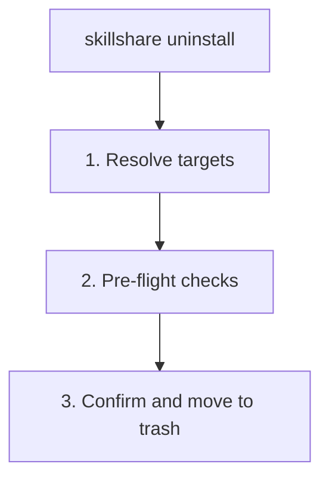

# uninstall

Remove one or more skills or tracked repositories from the source directory. Skills are moved to trash and kept for 7 days before automatic cleanup.

A global tracked declaration without a checkout can instead be removed as metadata only; see [Tracked Repositories](#tracked-repositories).

```bash
skillshare uninstall my-skill              # Remove a single skill
skillshare uninstall a b c --force         # Remove multiple skills at once
skillshare uninstall --all                 # Remove all skills
skillshare uninstall --group frontend      # Remove all skills in a group
skillshare uninstall team-repo             # Remove tracked repository (_ prefix optional)
```

## When to Use

- Remove skills you no longer need (they move to trash for 7 days)
- Clean up a tracked repository you've stopped using
- Batch-remove an entire group of skills at once
- Remove **all** skills at once with `--all`

```text
$ skillshare uninstall css-review
  frontend/css-review  ~/.config/skillshare/skills/frontend/css-review · 1 file
✓ Uninstall frontend/css-review → trash, kept 7 days

Next
  skillshare sync                               remove it from claude, cursor
  skillshare trash restore frontend/css-review  undo
```

## What Happens



## Options

| Flag | Description |
|------|-------------|
| `--all` | Remove **all** skills from source (requires confirmation) |
| `--group, -G <name>` | Remove all skills in a group (prefix match, repeatable) |
| `--force, -f` | Skip confirmation and ignore uncommitted changes |
| `--dry-run, -n` | Preview without making changes |
| `--project, -p` | Use project-level config in current directory |
| `--global, -g` | Use global config (`~/.config/skillshare`) |
| `--json` | Output JSON and skip confirmation; dirty tracked repositories still require `--force` |
| `--help, -h` | Show help |

## JSON Output

```bash
skillshare uninstall my-skill another-skill --json
```

```json
{
  "removed": ["my-skill", "another-skill"],
  "failed": [],
  "skipped": 0,
  "dry_run": false,
  "duration": "0.089s"
}
```

Combine with `--dry-run` to preview:

```bash
skillshare uninstall --all --json --dry-run
```

When every skill fails to uninstall, the command exits non-zero and the `error` field names each skill with its reason; when only some fail, they are listed in `failed` with their reasons and the command exits 0. `uninstall agents --json` exits non-zero when any agent fails, lists the failed names in `failed`, and gives each reason in `error`. JSON output works in project mode (`-p`) too.

## Multiple Skills

Remove several skills in one command:

```bash
skillshare uninstall alpha beta gamma --force
```

When some skills are not found, the command **skips them with a warning** and continues removing the rest. It only fails if **all** specified skills are invalid.

### Glob Patterns

Skill names support glob patterns (`*`, `?`, `[...]`) for batch removal:

```bash
skillshare uninstall "core-*"              # Remove all skills matching core-*
skillshare uninstall "test-?" --force      # Single-character wildcard
skillshare uninstall "core-*" "util-*"     # Multiple patterns
```

Glob matching is case-insensitive: `"Core-*"` matches `core-auth`, `CORE-DB`, etc.

:::note Top-level matching only
Glob patterns match against **top-level directory names** in the source folder. Nested skills (e.g. `frontend/react-hooks`) are not matched by `"react-*"` — use `--group frontend` to target skills within a subdirectory.
:::

`--group` refuses a [followed source link](../targets/configuration.md#follow_source_links) such as `_dev-skills`, because it would move every skill out of the real checkout. Use `skillshare unlink _dev-skills` to remove the link entry, or name the skills (`skillshare uninstall _dev-skills/foo`) to trash them from the checkout.

If the linked folder itself contains `SKILL.md`, uninstall refuses that root skill: moving it would remove the link and hide all nested skills. Use [`unlink`](./unlink.md) to remove only the link; the checkout stays untouched.

## Remove All

Use `--all` to remove every skill from the source directory at once:

```bash
skillshare uninstall --all                 # Interactive confirmation
skillshare uninstall --all --force         # Skip confirmation
skillshare uninstall --all -n              # Preview what would be removed
```

`--all` cannot be combined with skill names or `--group`.

:::tip Shell glob protection
Running `skillshare uninstall *` without quotes causes your shell to expand `*` into file names in the current directory. skillshare detects this and suggests using `--all` instead. Always quote the wildcard (`"*"`) or use `--all`.
:::

## Group Removal

When you uninstall a directory that contains sub-skills, skillshare automatically detects it as a **group** and lists the contained skills before asking for confirmation:

```
Uninstalling group (5 skills)
─────────────────────────────────────────
  - feature-radar
  - feature-radar-archive
  - feature-radar-learn
  - feature-radar-ref
  - feature-radar-scan
→ Name: feature-radar
→ Path: ~/.config/skillshare/skills/feature-radar

? Uninstall group feature-radar? moved to trash for 7 days   Yes   No
```

The `--group` flag removes all skills under a directory using **prefix matching**:

```bash
# Remove all skills under frontend/
skillshare uninstall --group frontend

# Also removes nested skills: frontend/react/hooks, frontend/vue/composables
skillshare uninstall --group frontend --force

# Preview what would be removed
skillshare uninstall --group frontend --dry-run
```

When group removal is applied (including auto-detected directory groups), each removed member is also removed from the managed `skills:` list in config (`~/.config/skillshare/config.yaml` or `.skillshare/config.yaml` in project mode).

You can combine positional names with `--group`, and even use `-G` multiple times:

```bash
# Mix names and groups
skillshare uninstall standalone-skill -G frontend -G backend --force

# Duplicates are automatically deduplicated
skillshare uninstall frontend/hooks -G frontend --force  # hooks removed once
```

## Tracked Repositories

For existing checkouts (including links to Git checkouts):

- Checks for uncommitted changes (use `--force` to override)
- Fails with `failed to check git status` when skillshare cannot read the repo's git status; other items in the batch are still removed, and `--force` skips the check
- Automatically removes the entry from `.gitignore`
- The `_` prefix is optional when uninstalling
- A repo installed with `--into` is named by its path, such as `devops/_team-skills`
- For `--into` repos, the final `_` is optional too: `devops/team-skills` resolves to `devops/_team-skills`. An existing skill or folder at the typed path takes precedence; use the explicit `_` path to remove the repo. Ambiguous short names fail and require the full path.
- A skill or folder inside a tracked repo cannot be removed on its own, even with `--force`; the command fails with `inside a tracked repo; uninstall the repo instead`. Skills below a followed source link can still be removed one at a time

```bash
skillshare uninstall _team-skills        # With prefix
skillshare uninstall team-skills         # Without prefix (auto-detected)
skillshare uninstall _team-skills --force # Force remove with uncommitted changes
skillshare uninstall devops/_team-skills # Repo installed with --into devops
skillshare uninstall devops/team-skills  # Same repo, unless this path already exists
```

- In global mode, an explicitly named tracked declaration with no checkout here (absent, a plain folder, or a link to a non-checkout) can be removed without contacting its source, even if the source is unreachable. Only its record and audit acceptances are removed: the occupant and `.gitignore` stay untouched, no Git check runs, and nothing goes to trash. `trash restore` cannot undo this removal. Use the canonical `_` name or full recorded path, such as `skillshare uninstall devops/_team-skills -g`; shorthand can select an existing skill or folder. Globs, `--all`, and `--group` do not select declarations without checkouts.

Deleting a checkout by hand leaves its global declaration. To restore missing checkouts instead of dropping their declarations, run `skillshare install -g` with reachable sources and free destinations. If a later `install` or reconcile walks a plain folder or followed link to a non-checkout at a declared path, it normalizes the entry to an ordinary record (`Tracked=false`); ordinary uninstall then moves the occupant to trash. Absent paths and unfollowed or unavailable links are not normalized this way.

## Examples

```bash
# Remove a single skill
skillshare uninstall my-skill

# Remove multiple skills
skillshare uninstall skill-a skill-b skill-c --force

# Remove all skills
skillshare uninstall --all
skillshare uninstall --all --force
skillshare uninstall --all -n              # Preview

# Remove by group
skillshare uninstall --group frontend --force

# Preview removal
skillshare uninstall my-skill --dry-run
skillshare uninstall --group frontend -n

# Remove tracked repository
skillshare uninstall team-repo

# Mix names and groups
skillshare uninstall my-skill -G frontend --force
```

## Safety

Uninstalled skills are **moved to trash**, not permanently deleted:

- **Location:** `~/.local/share/skillshare/trash/` (global) or `.skillshare/trash/` (project)
- **Retention:** 7 days, then automatically cleaned up
- **Reinstall hint:** If the skill was installed from a remote source, the reinstall command is shown
- **Restore:** Use `skillshare trash restore <name>` to recover from trash

Single skill (verbose):

```
  my-skill  ~/.config/skillshare/skills/my-skill · 2 files
✓ Uninstall my-skill → trash, kept 7 days

Next
  skillshare sync                                   remove it from claude, cursor
  skillshare trash restore my-skill                 undo
  skillshare install github.com/user/repo/my-skill  reinstall it later
```

Multiple skills (batch):

```
Failed
✗ bad-skill  failed to move to trash: ...

Removed
✓ pdf       skill
✓ tdd       skill
✓ security  group, 2 skills

! Uninstalled 3, 1 failed · 0.1s

Next
  skillshare sync        remove them from claude, cursor
  skillshare trash list  restore any of them within 7 days
```

Large batches use a condensed format:

```
Failed
✗ bad-a     failed to move to trash: permission denied
✗ bad-b     failed to move to trash: permission denied

Removed
✓ 920 uninstalled

! Uninstalled 920, 2 failed · 1.2s

Next
  skillshare sync        remove them from claude, cursor
  skillshare trash list  restore any of them within 7 days
```

To restore an accidentally uninstalled skill:

```bash
skillshare trash list                  # See what's in trash
skillshare trash restore my-skill      # Restore to source
skillshare sync                        # Sync back to targets
```

## After Uninstalling

Run `skillshare sync` to remove the skill from all targets:

```bash
skillshare uninstall old-skill
skillshare sync  # Remove from Claude, Pi, etc.
```

## Project Mode

Uninstall skills or tracked repos from the project's `.skillshare/skills/`:

```bash
skillshare uninstall my-skill -p                  # Remove a skill
skillshare uninstall a b c -p -f                  # Remove multiple skills
skillshare uninstall --all -p -f                   # Remove all project skills
skillshare uninstall --group frontend -p -f        # Remove a group
skillshare uninstall team-skills -p                # Tracked repo (_ prefix optional)
```

In project mode, uninstall:
- Moves the skill directory to `.skillshare/trash/` (kept 7 days)
- Removes the skill's entry from `.skillshare/config.yaml` `skills:` list (for remote skills)
- Removes the entry from `.skillshare/.gitignore` (for remote/tracked skills)
- Removes the skill's pin from `.skillshare/skills.lock.json` (for a group, every pin under it)
- For tracked repos: checks for uncommitted changes, and fails when the git status cannot be read (use `--force` to override both)
- The `_` prefix is optional — auto-detected
- Repos installed with `--into` work as in global mode: `devops/team-skills -p` resolves to `devops/_team-skills`, and a skill or folder inside a tracked repo cannot be removed on its own

```bash
skillshare uninstall pdf -p
skillshare sync
git add .skillshare/ && git commit -m "Remove pdf skill"
```

## Agent Support

Use `--kind agent` to uninstall agents instead of skills:

```bash
skillshare uninstall --kind agent tutor              # Remove an agent
skillshare uninstall --kind agent tutor reviewer -f   # Remove multiple agents
skillshare uninstall --kind agent --all               # Remove all agents
```

Agent uninstall follows the same trash-and-retain behavior as skills (moved to trash, kept 7 days). See [Agents](/docs/understand/agents) for background.

## See Also

- [install](/docs/reference/commands/install) — Install skills
- [list](/docs/reference/commands/list) — List installed skills
- [trash](/docs/reference/commands/trash) — Manage trashed skills
- [Project Skills](/docs/understand/project-skills) — Project mode concepts
- [Agents](/docs/understand/agents) — Agent concepts
