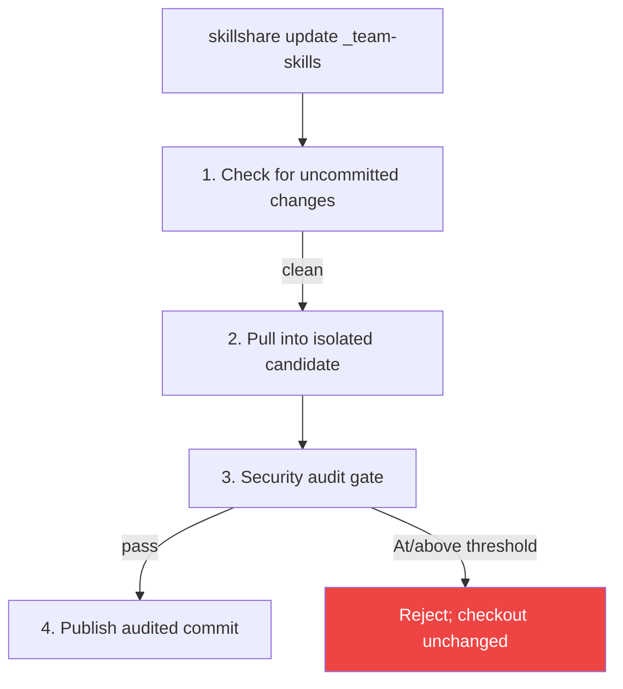
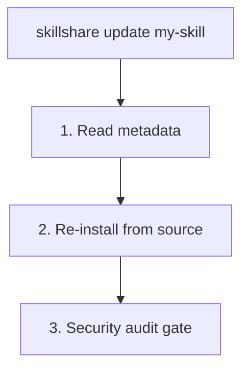

# update

Update one or more skills or tracked repositories to the latest version.

```bash
skillshare update my-skill           # Update single skill
skillshare update a b c              # Update multiple at once
skillshare update --group frontend   # Update all skills in a group
skillshare update team-skills        # Update tracked repo
skillshare update --all              # Update everything
skillshare update agents --all       # Update all tracked/updatable agents
```

## When to Use

- A tracked repository has new commits (found via `check`)
- An installed skill has a newer version available
- You want to re-download a skill from its original source

```text
$ skillshare update pdf
✓ Update    pdf · from github.com/anthropics/skills/skills/pdf · 1.9s
✓ Audit     no findings

Next
  skillshare sync  link the changes into your targets
```

## What Happens

### For Tracked Repositories



### For Regular Skills

Skills installed from a remote source are reinstalled from it. Skills installed from a local path (`skillshare install /path/to/skill`) are re-copied from that path, so `update` picks up changes made there; [`check`](./check.md#local-path-installs) reports when that path has changed.



## Options

| Flag | Description |
|------|-------------|
| `--all, -a` | Update all tracked repos/skills, or all agents when used as `update agents --all`. A tracked repo behind a [followed source link](../targets/configuration.md#follow_source_links) is skipped with a warning, since it is your own checkout; update it by name |
| `--group, -G <name>` | Update all updatable skills in a group, or all agents in an agent subdirectory |
| `--force, -f` | Discard local changes, proceed despite audit findings, and reinstall remote skills that are already at the upstream commit |
| `--dry-run, -n` | Preview without making changes |
| `--skip-audit` | Skip the security audit gate |
| `--audit-threshold <t>`, `--threshold <t>`, `-T <t>` | Override update audit block threshold (`critical|high|medium|low|info`; shorthand: `c|h|m|l|i`, plus `crit`, `med`) |
| `--diff` | Show file-level change summary after skill/repo update |
| `--audit-verbose` | Show detailed per-skill audit findings in batch mode |
| `--prune` | Remove stale skills (deleted upstream) instead of warning |
| `--project, -p` | Use project-level config in current directory |
| `--global, -g` | Use global config (`~/.config/skillshare`) |
| `--json` | Output as JSON |
| `--help, -h` | Show help |

`update agents` supports: `--all`, `--group`, `--force`, `--dry-run`, `--skip-audit`, `--audit-threshold` / `--threshold` / `-T`, `--json`, plus `--project` / `--global`. It does **not** support `--diff`, `--audit-verbose`, or `--prune`.

## JSON Output

```bash
skillshare update --all --json
```

```json
{
  "updated": 3,
  "skipped": 1,
  "security_failed": 0,
  "pruned": 0,
  "dry_run": false,
  "duration": "4.567s",
  "items": [
    {"name": "_team-skills", "type": "repo", "status": "updated"},
    {"name": "my-skill", "type": "skill", "status": "updated"},
    {"name": "another-skill", "type": "skill", "status": "updated"},
    {"name": "local-only", "type": "skill", "status": "skipped"}
  ]
}
```

Possible `status` values: `updated`, `skipped`, `failed`, `security_blocked`. When an item fails, the `error` field is included. A remote skill skipped for its local changes is a `skipped` item with `"error": "local changes since install"`.

When a batch update finds remote skills already at the upstream commit, it leaves them alone and counts them in an `up_to_date` field. The field is omitted when the count is zero.

When tracked repos are declared in metadata but missing on disk, each is reported as a skipped `repo` item with a concise `error` (`clone directory absent`), and an aggregated `missing_tracked_repos` summary carries the names plus a one-shot rehydration hint:

```json
{
  "updated": 0,
  "skipped": 1,
  "items": [
    {"name": "_team-skills", "type": "repo", "status": "skipped", "error": "clone directory absent"}
  ],
  "missing_tracked_repos": {
    "names": ["_team-skills"],
    "hint": "Run 'skillshare install' to rehydrate tracked repositories"
  }
}
```

The `missing_tracked_repos` field is omitted when no tracked repos are missing.

### Agent JSON Output

```bash
skillshare update agents --all --json
```

```json
{
  "agents": [
    {"name": "reviewer", "status": "updated", "source": "github.com/user/agents/reviewer.md"},
    {"name": "team/tutor", "status": "up_to_date", "source": "github.com/user/agents/team/tutor.md"}
  ],
  "dry_run": false,
  "duration": "1.234s"
}
```

Possible agent `status` values include `updated`, `failed`, `skipped`, `up_to_date`, `update_available`, `dirty`, `drifted`, and `local`.

## Updating Agents

Use the `agents` kind selector when you only want to update standalone `.md` agents:

```bash
skillshare update agents reviewer
skillshare update agents --group team
skillshare update agents --all -T high
skillshare update agents --all --json
```

Agent updates follow the same audit gate as skills:

- tracked agent repos run `git pull`, then audit the updated repo
- metadata-backed single-file agents reinstall from source, audit the staged `.md`, and only replace the local file on success

## Update Multiple

Update several skills at once:

```bash
skillshare update skill-a skill-b skill-c
```

Only updatable skills (tracked repos or skills with metadata) are processed. Skills not found are warned but don't cause failure. However, if any skill is **blocked by the security audit gate**, the batch command exits with a non-zero code.

### Glob Patterns

Skill names support glob patterns (`*`, `?`, `[...]`) for batch operations:

```bash
skillshare update "core-*"              # Update all skills matching core-*
skillshare update "_team-?"             # Single-character wildcard
skillshare update "core-*" "util-*"     # Multiple patterns
```

Glob patterns match against the **basename** (last path component) of each skill or tracked repo. For example, `"react-*"` matches `frontend/react-hooks` because the basename is `react-hooks`.

Glob matching is case-insensitive: `"Core-*"` matches `core-auth`, `CORE-DB`, etc.

:::tip Shell glob protection
Always quote glob patterns (`"core-*"`) to prevent your shell from expanding `*` into file names in the current directory.
:::

## Update Group

Update all updatable skills within a group directory:

```bash
skillshare update --group frontend        # Update all in frontend/
skillshare update -G frontend -G backend  # Multiple groups
skillshare update x -G backend            # Mix names and groups
```

Local skills (without metadata or `.git`) inside the group are silently skipped.

A positional argument that matches a group directory (not a repo or skill) is auto-expanded:

```bash
skillshare update frontend   # Same as --group frontend
#   'frontend' is a group — expanding to 3 updatable skills
```

:::note
`--all` cannot be combined with skill names or `--group`.
:::

## Update All

Update everything at once:

```bash
skillshare update --all
```

This updates:
1. All tracked repositories (git pull)
2. All skills with source metadata (reinstall when upstream changed)

`update --all` and `update --group` group remote skills by repository and clone each repository once. They leave alone any skill whose folder did not change upstream and count it as up to date. A skill whose folder contains a symlink is the exception: its files can change without the folder changing, so it is reinstalled whenever the upstream commit moves. Several skills named in project mode (`-p`) work the same way. Use `--force` to reinstall every skill anyway. A single skill, and skills named in global mode, are always reinstalled. A skill whose files you changed since install is skipped in every case until you add `--force` (see [Handling Conflicts](#handling-conflicts)). When a repository cannot be fetched, its skills count as skipped and `update` prints a warning naming the repository and the error, with any credentials in the URL removed.

### Example Output

```
$ skillshare update --all

✓ Audit     3 skills, no findings

✓ Updated 4, 12 up to date, 1 skipped · 6.2s

Next
  skillshare sync  link the changes into your targets
```

### Missing Tracked Repositories

If `.metadata.json` declares a tracked repo (`tracked: true`) but its clone directory is absent on disk — common on a fresh machine, since clone directories live in the managed `.gitignore` block — `update --all` no longer skips it silently. It reports each missing repo and points you to rehydrate:

```
! 1 tracked repo declared in metadata but missing on disk
! _team-skills  clone directory absent
  Run 'skillshare install' to rehydrate tracked repositories
```

This applies to both global and project (`-p`) mode. To recreate the clones from metadata, run no-argument [install](/docs/reference/commands/install) (see [Rehydrating After a Fresh Clone](/docs/understand/tracked-repositories#rehydrating-after-a-fresh-clone)).

## Stale Skill Cleanup (`--prune`)

When an upstream repository renames or removes a skill, `update` detects it as **stale** and warns you:

```
Deleted upstream
! frontend/old-skill  stale — no longer in the upstream repository
  Run with --prune to remove them
```

Add `--prune` to automatically remove stale skills (moved to trash, not permanently deleted):

```bash
skillshare update --all --prune
```

`check` also reports stale skills:

```bash
skillshare check --all
# ! old-skill  stale — no longer in the upstream repository
```

:::note
Tracked repositories (`_repo`) are not affected by `--prune`. When a tracked repo removes a skill internally, `sync` automatically cleans up orphan symlinks via `PruneOrphanLinks`.
:::

## Security Audit Gate {#security-audit-gate}

Before publishing tracked updates, `update` audits an isolated candidate. The active checkout and existing target links keep serving the old content until approval:

- **Tracked repos (`git pull`)** pull and scan in a private checkout at the active threshold (`audit.block_threshold`, default `CRITICAL`), then publish the exact audited commit without another upstream pull
- **Regular skills (reinstall path)** use the same threshold policy
- For all update types, risk label/score is displayed for review context

```
→ risk: LOW (12/100)
```

### Interactive Mode (TTY, tracked repos)

When findings are detected at or above the active threshold, you're prompted to decide:

```
  [HIGH] Source repository link detected — may be used for supply-chain redirects (SKILL.md:5)

  Security findings at or above active threshold detected.
? Apply anyway?   Yes   No
```

- **Yes** — Accept the update despite findings
- **No** (default) — Discard the candidate; the active checkout stays unchanged

### Non-Interactive Mode (CI/CD)

In non-interactive environments, blocking findings reject the candidate and the command exits with a non-zero code. Scan errors also leave the active checkout and metadata unchanged, even with `--force`. Publication is not an atomic multi-file switch.

```bash
# Bypass the audit gate when you trust the source
skillshare update --all --skip-audit
```

:::caution
`--skip-audit` disables the security scan entirely. Use it only when you trust the source or have an external audit process.
:::

### Accepted Findings {#accepted-findings}

When you override the gate with `--force` (or answer `y` at the prompt), the findings you accepted are recorded in `.metadata.json` under `audit_accepted`. Later updates of the same skill no longer block on those exact findings, so you do not have to repeat `--force` on every `update --all`. Force Retry on the dashboard's **Updates** tab records them the same way, and both honor findings accepted from either one.

```
  1 previously accepted finding skipped
```

A finding is matched by rule, file, and matched text — not by line number — so it stays accepted when unrelated content shifts. Any new finding, or the same rule matching different text, blocks again. This suits skills that legitimately quote attack strings as examples (security scanners, red-team docs) while still catching new payloads in later versions.

You can override threshold per command with `--audit-threshold`, `--threshold`, or `-T`:

```bash
skillshare update _team-skills --threshold high
skillshare update --all -T h
```

## File Change Summary (`--diff`)

Use `--diff` to see a file-level change summary after each update:

```bash
skillshare update team-skills --diff
skillshare update --all --diff
```

For **tracked repositories**, the diff uses `git diff` and includes line-level statistics:

```
Files changed
  ~ SKILL.md (+12 -3)
  + scripts/deploy.sh (+45 -0)
  - old-helper.sh (+0 -22)
  ~ utils/format.md (+5 -2)
```

For **regular skills** (installed from a remote source), the diff compares file hashes before and after the reinstall:

```
Files changed
  ~ SKILL.md
  + new-helper.sh
```

Markers: `+` added, `-` deleted, `~` modified. Shows up to 20 files; additional files are summarized as "... and N more file(s)".

## Handling Conflicts

If a tracked repo has uncommitted changes:

```bash
# Option 1: Commit your changes first
cd ~/.config/skillshare/skills/_team-skills
git add . && git commit -m "My changes"
skillshare update _team-skills

# Option 2: Discard and force update
skillshare update _team-skills --force
```

If skillshare cannot read the repo's git status, the update fails for that repo with `failed to check git status`; `--force` skips the check.

A skill installed from a repository is protected the same way. When its files no longer match the ones recorded at install time, `update` skips it and reports `local changes since install`; `skillshare check` lists it as modified, and `skillshare check <name> --diff` shows what you changed. Copy your edits elsewhere if you want to keep them, then discard them:

```bash
skillshare update my-skill --force
```

On the dashboard's **Updates** tab, the skill shows **Modified locally** and a **View changes** button that opens its changes on the skill's page; tick **Force overwrite local edits** before updating it, or use **Force Retry** on the skipped row. Updating it from the skill's own page shows the changes and asks before discarding them. `update <name> --dry-run` reports the skill as one it would skip. A modified skill that was also deleted upstream is kept until you add `--force`, even with `--prune`.

## After Updating

Run `skillshare sync` to distribute changes to all targets:

```bash
skillshare update --all --diff   # Update with file-level change summary
skillshare sync
```

## Project Mode

Update skills and tracked repos in the project:

```bash
skillshare update pdf -p              # Update single skill (reinstall)
skillshare update a b c -p            # Update multiple skills
skillshare update --group frontend -p # Update all in a group
skillshare update team-skills -p      # Update tracked repo (git pull)
skillshare update --all -p            # Update everything
skillshare update --all -p --dry-run  # Preview
skillshare update --all -p --diff     # Update with file change summary
skillshare update --all -p --skip-audit  # Skip security audit gate
```

### How It Works

| Type | Method | Detected by |
|------|--------|-------------|
| **Tracked repo** (`_repo`) | `git pull` | `_`-prefixed folder with a `.git/` directory |
| **Remote skill** (with metadata) | Reinstall from source when upstream changed | Listed in `.metadata.json` |
| **Local-path install** | Re-copy from the recorded path | Listed in `.metadata.json` with `type: local` |
| **Local skill** | Skipped | Not listed in `.metadata.json` |

The `_` prefix is optional, on the last path segment too — `skillshare update team-skills -p` auto-detects `_team-skills`, and `skillshare update devops/team-skills -p` finds a repo installed with `--into devops` at `devops/_team-skills`.

### Lockfile

`update -p` is how a pinned commit moves forward. Each skill or tracked repo that lands on a new commit gets its entry in `.skillshare/skills.lock.json` rewritten; skills that did not change keep their pin. Commit the lockfile so teammates get the same commit on their next `skillshare install -p`. See [Lockfile](/docs/understand/project-skills#lockfile).

### Handling Conflicts

Tracked repos with uncommitted changes are blocked by default:

```bash
# Option 1: Commit changes first
cd .skillshare/skills/_team-skills
git add . && git commit -m "My changes"
skillshare update team-skills -p

# Option 2: Discard and force update
skillshare update team-skills -p --force
```

If skillshare cannot read the repo's git status, the update fails for that repo with `failed to check git status`; `--force` skips the check.

### Typical Workflow

```bash
skillshare update --all -p
skillshare sync
git add .skillshare/ && git commit -m "Update remote skills"
```

## See Also

- [install](/docs/reference/commands/install) — Install skills
- [upgrade](/docs/reference/commands/upgrade) — Upgrade CLI and built-in skill
- [sync](/docs/reference/commands/sync) — Sync to targets
- [Project Skills](/docs/understand/project-skills) — Project mode concepts
