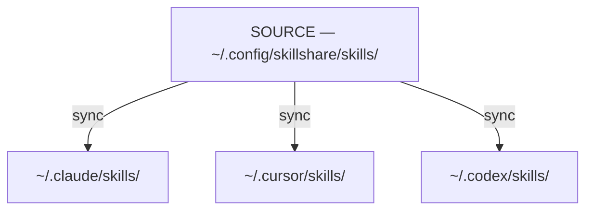
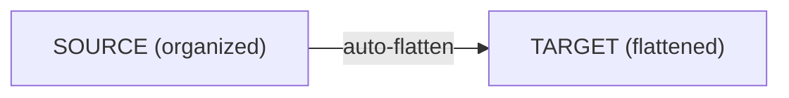

# Source & Targets

The core model behind skillshare: one source, many targets.

:::tip When does this matter?
Understanding source vs targets helps you know where to edit skills and agents (always in source — changes reflect via symlinks), why `sync` is a separate step, and how `collect` works in the reverse direction.
:::

## The Problem

Without skillshare, you manage skills separately for each AI CLI:

```
~/.claude/skills/         # Edit here
  └── my-skill/

~/.cursor/skills/         # Copy to here
  └── my-skill/           # Now out of sync!

~/.codex/skills/          # And here
  └── my-skill/           # Also out of sync!
```

**Pain points:**
- Edits in one place don't propagate
- Skills drift apart over time
- No single source of truth

---

## The Solution

skillshare introduces a **source directory** that syncs to all **targets**:



**Benefits:**
- Edit in source → all targets update instantly
- Edit in target → changes go to source (via symlinks)
- Single source of truth

---

## Why Sync is a Separate Step {#why-sync-is-a-separate-step}

Operations like `install`, `update`, and `uninstall` only modify the **source** directory. A separate `sync` step maintains target links and refreshes managed copies. This two-phase design is intentional:

**Preview before propagating** — Run `sync --dry-run` to review what will change across all targets before applying. Especially useful after `uninstall` or `--force` operations.

**Batch multiple changes** — Install 5 skills, then sync once. Without separation, each install would trigger a full scan and symlink update across all targets.

**Recoverable removal** — `uninstall` moves skills to a trash directory (kept 7 days) instead of permanently deleting them, so accidental removals are recoverable.

:::tip Exception: pull
`pull` automatically runs sync after `git pull`. Since its intent is "bring everything up to date from remote," auto-syncing matches the expected behavior.
:::

:::info When sync is NOT needed
Editing or updating existing skill content doesn't require sync for targets that already symlink to it: they read the updated source immediately. Run sync when links need to be added, removed, or renamed, when copied content changes, or when target paths, filters, or modes change.
:::

---

## Source Directory

**Default location:** `~/.config/skillshare/skills/`

This is where:
- You create and edit skills
- Skills are installed to
- Git tracks changes (for cross-machine sync)

:::tip Symlinked source directories
The source directory can be a symlink — common when using dotfiles managers (GNU Stow, chezmoi, yadm). For example, `~/.config/skillshare/skills/ → ~/dotfiles/ss-skills/`. Skillshare resolves the source root before scanning, so commands work transparently with that root. Chained source-root symlinks are also supported.

Links directly **under** the skills source are a separate opt-in: `follow_source_links: true` in the global or project config follows first-level directory symlinks (Unix) or junctions (Windows) under their link names. [`skillshare link <path>`](../reference/commands/link.md) creates such a link. The default is `false`; discovery ignores these links and `doctor` reports them as not followed. Deeper links are not followed for discovery. See [Configuration — `follow_source_links`](../reference/targets/configuration.md#follow_source_links) for examples, the decision flow, safety guards, and writes through the link.
:::

**Structure:**
```
~/.config/skillshare/skills/
├── my-skill/
│   └── SKILL.md
├── code-review/
│   └── SKILL.md
├── _team-skills/          # Tracked repo (underscore prefix)
│   ├── frontend/
│   │   └── ui/
│   └── backend/
│       └── api/
└── ...
```

### Organize with Folders (Auto-Flattening) {#organize-with-folders-auto-flattening}

You can use folders to organize your own skills — they'll be auto-flattened when synced to targets:



**Benefits:**
- Organize skills by project, team, or category
- No manual flattening required
- AI CLIs get the flat structure they expect
- Folder names become prefixes for traceability

---

## Agents Source

Agents are a parallel resource kind to skills. They live in their own source directory next to `skills/` and follow the same source-and-targets model:

```
~/.config/skillshare/
├── skills/                    # Skills source (directories)
│   └── my-skill/
│       └── SKILL.md
└── agents/                    # Agents source (single .md files)
    ├── reviewer.md
    └── auditor.md
```

The same `skillshare init` run creates both directories. Agents are single `.md` files (no nested directories) and are synced via `skillshare sync` (or `skillshare sync agents` to scope to agents only).

**Targets that support agents.** Not every AI CLI exposes an agents directory. The targets that do are:

- `~/.claude/agents/` — Claude Code
- `~/.cursor/agents/` — Cursor
- `~/.augment/agents/` — Augment
- `~/.config/opencode/agents/` — OpenCode
- `~/.factory/droids/` — Droid

Other targets are silently skipped during agent sync (with a `No agents folder: <targets>` warning). The same merge / copy / symlink modes that apply to skills also apply to agents.

See [Agents](/docs/understand/agents) for the full agent file format, `.agentignore` rules, and discovery semantics.

---

## Custom Source Directories

By default, global mode reads skills from `~/.config/skillshare/skills/`, agents from `~/.config/skillshare/agents/`, and derives the extras parent from the skills source. Since v0.19.16, the optional top-level `sources` map lets you override any of these:

```yaml
# ~/.config/skillshare/config.yaml
sources:
  skills: ~/work/skills
  agents: ~/work/agents
  extras: ~/work/extras
targets:
  claude:
    skills:
      path: ~/.claude/skills
```

Each key is optional — omit a key to keep its built-in default. Paths support `~` (home expansion) and absolute paths.

**Common layouts:**

```yaml
# Point all three at a shared dotfiles directory
sources:
  skills: ~/dotfiles/skillshare/skills
  agents: ~/dotfiles/skillshare/agents
  extras: ~/dotfiles/skillshare/extras

# Override only skills; agents and extras keep their defaults
sources:
  skills: ~/projects/team-skills
```

### Backward Compatibility

The pre-v0.19.16 top-level fields are still accepted and continue to work unchanged:

```yaml
# Legacy format — fully supported, no auto-migration on save
source: ~/.config/skillshare/skills
agents_source: ~/.config/skillshare/agents
extras_source: ~/.config/skillshare/extras
```

When both formats are present, the `sources.<key>` value wins over the corresponding legacy field. Existing configs are never auto-rewritten; only fresh `skillshare init` runs emit the new `sources:` shape.

### When This Matters

The same feature exists in project mode (see [Project Skills](/docs/understand/project-skills#custom-source-directories) for the project-mode form, which also supports relative paths from the project root).

---

## Targets

Targets are AI CLI skill directories that skillshare syncs to.

**Common targets:**
- `~/.claude/skills/` — Claude Code
- `~/.cursor/skills/` — Cursor
- `~/.agents/skills/` — OpenAI Codex CLI (the shared `universal` directory)
- `~/.gemini/config/skills/` — Antigravity (app)
- `~/.gemini/antigravity-cli/skills/` — Antigravity CLI
- `~/.gemini/skills/` — Gemini CLI
- And [79 targets in all](/docs/reference/targets/supported-targets)

**Auto-detection:** When you run `skillshare init`, it automatically detects installed AI CLIs and adds them as targets.

**Manual addition:**
```bash
skillshare target add myapp ~/.myapp/skills
```

---

## How Sync Works

### Source → Targets (`sync`)

```bash
skillshare sync
```

Creates symlinks from each target to the source:
```
~/.claude/skills/my-skill → ~/.config/skillshare/skills/my-skill
```

### Target → Source (`collect`)

```bash
skillshare collect claude
```

Collects local skills from a target back to source:
1. Finds non-symlinked skills in target
2. Copies them to source (`.git/` directories are excluded automatically)
3. Replaces with symlinks

---

## Editing Skills

Because targets are symlinked to source, you can edit from anywhere:

**Edit in source:**
```bash
$EDITOR ~/.config/skillshare/skills/my-skill/SKILL.md
# Changes visible in all targets immediately
```

**Edit in target:**
```bash
$EDITOR ~/.claude/skills/my-skill/SKILL.md
# Changes go to source (same file via symlink)
```

---

## See Also

- [sync](/docs/reference/commands/sync) — Propagate changes from source to targets
- [collect](/docs/reference/commands/collect) — Pull skills from targets back to source
- [Sync Modes](./sync-modes.md) — How files are linked (merge, copy, symlink)
- [Agents](./agents.md) — Agent resource model and discovery
- [Configuration](/docs/reference/targets/configuration) — Target config reference
