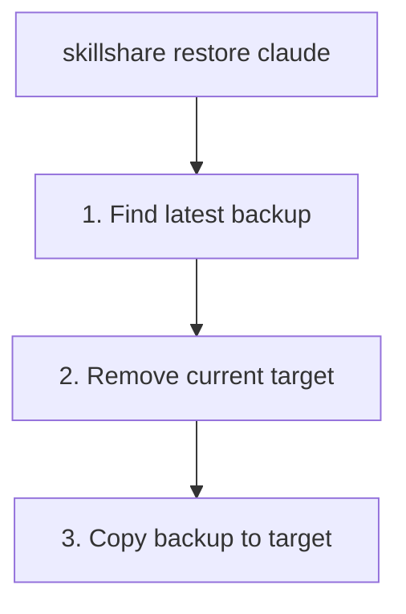

# restore

バックアップから target を復元します。

```bash
skillshare restore                                     # 対話式 TUI（参照 + 復元）
skillshare restore claude                              # 最新のバックアップ
skillshare restore claude --from 2026-01-19_10-00-00   # 特定のバックアップ
skillshare restore claude --dry-run                    # プレビュー
```

## 使うタイミング

- sync が失敗し、target を以前の状態に戻す必要がある
- 誤って target から Skill を削除してしまった
- バックアップバージョンを対話的に参照し、現在の状態と比較する

## 対話式 TUI

TTY 上で引数なしの `skillshare restore` を実行すると、まずバックアップとゴミ箱のどちらから復元するかを尋ねます。バックアップを選ぶと、ターゲットを選んでそのバックアップバージョンを閲覧できます。各バージョンには日付、サイズ、現在のターゲットと比べて追加・削除される項目が表示され、古いバージョンをここから削除することもできます。ゴミ箱を選ぶと trash TUI が開きます。キーは画面下部に表示されます。

TUI をスキップしてプレーンなバックアップ一覧を表示するには `--no-tui` を使用します。

## 実行内容



## オプション

| フラグ | 説明 |
|------|-------------|
| `--all` | 従来のグローバル skills の復元処理を使用（agents は別途復元） |
| `--project, -p` | `.skillshare/backups/` から指定した skills または agents を復元 |
| `--global, -g` | global mode を使用（skills のデフォルト） |
| `--from, -f <timestamp>` | 特定のバックアップから復元 |
| `--force` | 空でない復元先フォルダーを置き換える |
| `--dry-run, -n` | 変更を加えずにプレビュー |
| `--no-tui` | 対話式 TUI をスキップし、バックアップ一覧を表示 |

`restore` は位置引数として kind も受け付けます: `skillshare restore agents claude` は `claude` target の agent バックアップを復元します。

## バックアップを探す

利用可能なバックアップを一覧表示します。

```bash
skillshare backup --list
```

```
Backups  ~/.local/share/skillshare/backups
  2026-01-20_15-30-00  claude, cursor · 4.2 MB
  2026-01-19_10-00-00  claude · 2.1 MB
  2026-01-18_09-00-00  claude, cursor · 4.0 MB

3 backups, 10.3 MB

Next
  skillshare restore <target> --from <timestamp>  roll a target back
```

## 例

```bash
# 最新のバックアップから復元
skillshare restore claude

# 特定のバックアップから復元
skillshare restore claude --from 2026-01-19_10-00-00

# 復元をプレビュー
skillshare restore claude --dry-run

# 強制復元（確認をスキップ）
skillshare restore claude --force
```

## 復元後

`restore` は target ディレクトリをスナップショットの内容で置き換えます。バックアップはローカルのコンテンツのみをキャプチャするため — シンボリックリンクされた Skill は除外されます。詳細は [What Gets Backed Up](/docs/reference/commands/backup#what-gets-backed-up) を参照してください — sync された Skill を戻すには、その後に `sync` を実行してください。

```bash
skillshare restore claude    # バックアップからローカルコンテンツを復元
skillshare sync              # sync された Skill のシンボリックリンクを再作成
```

復元されたコンテンツは通常のファイルであり、シンボリックリンクではありません。target がローカルの Skill しか保持していなかった場合は、restore だけで十分です。

## ユースケース

### 誤削除

Skill を誤って削除してしまった場合:

```bash
skillshare restore claude --from 2026-01-19_10-00-00
```

### 変更を元に戻す

sync が失敗した場合:

```bash
skillshare restore claude  # sync 前の状態に戻す
```

### テスト

古い Skill バージョンをテストするために復元します。

```bash
skillshare restore claude --from 2026-01-15_10-00-00
# 古い skills をテスト...
skillshare sync  # 現在の状態に戻す
```

### Agent の復元

Agent の restore は skill の restore と同様に動作しますが、`backup agents`（および `sync agents` の前に実行される自動バックアップ）によって作成された並行する `<target>-agents` バックアップエントリに対して操作します。

```bash
skillshare restore agents claude                       # claude の最新 agent バックアップ
skillshare restore agents claude --from 2026-01-19_10-00-00
skillshare restore agents claude -p                    # Project agents
```

## プロジェクトの skills を復元

プロジェクトのルートから名前を明示して実行します。

```bash
skillshare backup --list -p
skillshare restore goose --from 2026-01-19_10-00-00 -p --dry-run
skillshare restore goose --from 2026-01-19_10-00-00 -p --force
```

既存のプロジェクト skills スナップショットを復元します。手動の `backup -p` は引き続き `agents` が必要です。プロジェクト内でも、通常の skills restore と `-g` はグローバルのバックアップを使います。名前なしの `restore -p` は使用法エラーとなり、対話式選択はグローバルのままです。従来の `--all` は `-p` 付きでもグローバル skills の処理を使うため、agents は別に復元してください。

`goose-moved-2e676f6f73652f736b696c6c73` のような認識済みの名前は `.goose/skills` を復元し、現在の `.agents/skills` は変更しません。接尾辞は正規化した相対ディレクトリの16進表現です。target と旧パスの定義が必要で、未定義または曖昧な対応は拒否されます。一覧の正確な名前に `--from`、`-p` を指定し、空でないフォルダーには `--force` を使います。既存のダッシュボード Backup も同じ対応を使います。

復元は宛先フォルダー全体を置き換え、シンボリックリンクの内容は含みません。アクティブな profile は変更しません。次の sync は旧ディレクトリの未変更項目を削除できるため、残したい編集は先に source に保存してください。

`skillshare backup --list` でバックアップを一覧表示する際、agent バックアップは `-agents` サフィックス（例: `claude-agents`）付きの別エントリとして表示されます。

## 関連項目

- [backup](/docs/reference/commands/backup) — バックアップの作成と管理
- [sync](/docs/reference/commands/sync) — 復元後に再 sync
- [Agents](/docs/understand/agents) — Agent リソースモデル
