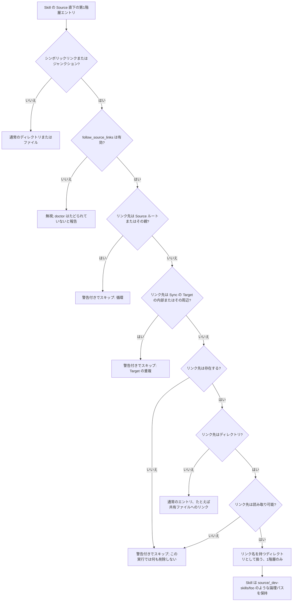

# Configuration

skillshare の Config ファイルリファレンスです。

## 概要

```text
~/.config/skillshare/
├── config.yaml          ← Config ファイル
├── skills/              ← Source ディレクトリ（あなたの Skill）
│   ├── .metadata.json   ← Skill メタデータ（自動管理）
│   ├── my-skill/
│   ├── another/
│   └── _team-repo/      ← Tracked リポジトリ
├── extras/              ← Extras Source ルート
│   └── rules/           ← Extra リソース（例: rules）

~/.local/share/skillshare/
└── backups/             ← 自動バックアップ
    └── 2026-01-20.../
```

---

## IDE 対応（JSON Schema） {#ide-support}

Config ファイルには、対応エディタで **自動補完**、**バリデーション**、**ホバードキュメント** を有効にする
YAML Language Server ディレクティブが含まれています。

`skillshare init` で作成された新しい Config には、これが自動的に含まれます。

```yaml
# yaml-language-server: $schema=https://raw.githubusercontent.com/runkids/skillshare/main/schemas/config.schema.json
source: ~/.config/skillshare/skills
targets:
  claude:
    path: ~/.claude/skills
```

### 既存の Config に追加する

この機能が導入される前に作成された Config には、**1行目** にコメントを追加してください。

**グローバル Config**（`~/.config/skillshare/config.yaml`）:
```yaml
# yaml-language-server: $schema=https://raw.githubusercontent.com/runkids/skillshare/main/schemas/config.schema.json
```

**プロジェクト Config**（`.skillshare/config.yaml`）:
```yaml
# yaml-language-server: $schema=https://raw.githubusercontent.com/runkids/skillshare/main/schemas/project-config.schema.json
```

または単純に `skillshare init --force`（グローバル）や `skillshare init -p --force`（プロジェクト）を
再実行して、スキーマコメント付きで Config を再生成してください。

### 対応エディタ

| エディタ | 必要な拡張機能 |
|--------|-------------------|
| VS Code | Red Hat の [YAML](https://marketplace.visualstudio.com/items?itemName=redhat.vscode-yaml) |
| JetBrains IDE | 組み込みの YAML 対応 |
| Neovim | LSP 経由の [yaml-language-server](https://github.com/redhat-developer/yaml-language-server) |

---

## Config ファイル

**場所:** `~/.config/skillshare/config.yaml`

### 完全な例

```yaml
# yaml-language-server: $schema=https://raw.githubusercontent.com/runkids/skillshare/main/schemas/config.schema.json
# Source ディレクトリ（Skill を編集する場所）
source: ~/.config/skillshare/skills

# Skill の Source 直下のディレクトリリンクをたどる（オプトイン）
# follow_source_links: true

# 新しい Target のデフォルト Sync モード
mode: merge

# デフォルトの Target 命名（flat、standard、または prefixed）
# target_naming: flat

# Target（AI CLI の Skill ディレクトリ）
targets:
  claude:
    path: ~/.claude/skills
    # mode: merge（デフォルトを継承）

  codex:
    path: ~/.codex/skills
    mode: symlink  # デフォルトモードを上書き
    include: [codex-*] # merge/copy モードのみ

  cursor:
    path: ~/.cursor/skills
    mode: copy  # Cursor 用に実ファイルを使う
    exclude: [experimental-*] # merge/copy モードのみ

  # カスタム Target
  myapp:
    path: ~/apps/myapp/skills

# リモート Skill — install/uninstall で自動管理される
skills:
  - name: pdf
    source: anthropics/skills/skills/pdf
  - name: _team-skills
    source: github.com/team/skills
    tracked: true

# 保存時に $HOME → ~ に折りたたむ（dotfiles フレンドリー）
# preserve_tilde_on_save: true

# commit/push/pull 対象のディレクトリ（skills がデフォルト、agents、extras、root）
# git_root: skills

# カスタム agents Source（オプション、デフォルトの場所を上書き）
agents_source: ~/my-agents

# カスタム extras Source（オプション、デフォルトの場所を上書き）
extras_source: ~/my-extras

# 任意のディレクトリに Sync する非 Skill リソース
extras:
  - name: rules
    source: ~/company-shared/rules   # オプションの extra 単位の上書き
    targets:
      - path: ~/.claude/rules
      - path: ~/.cursor/rules
        mode: copy

# Sync 時に無視するファイル
ignore:
  - "**/.DS_Store"
  - "**/.git/**"
  - "**/node_modules/**"
  - "**/*.log"
```

---

## フィールド

### `source`

あなたの Skill ディレクトリへのパス（唯一の信頼できる情報源）。

```yaml
source: ~/.config/skillshare/skills
```

**デフォルト:** `~/.config/skillshare/skills`

### `follow_source_links` {#follow_source_links}

Skill の Source 直下に置かれたシンボリックリンク（Unix）またはジャンクション（Windows）を通じて Skill を検出する機能にオプトインします。

| フィールド | 型 | デフォルト | スコープ |
|-------|------|---------|-------|
| `follow_source_links` | boolean | `false` | グローバルおよびプロジェクト Config |

```yaml title="~/.config/skillshare/config.yaml"
follow_source_links: true
```

デフォルトの `false` では、discovery は第1階層のリンクを無視し、`skillshare doctor` はそれらを「たどられていない」として報告します。`true` にすると、ディレクトリを指す第1階層のリンクは、そのリンク名を持つディレクトリとして扱われます。ツリーのより深い階層にあるリンクは discovery ではたどられません。この設定は、Source ルート自体をリンクにすることとは別物です。後者はオプトインなしで既にサポートされています。

たとえば、[`skillshare link`](../commands/link.md) で既存のチェックアウトを Source にリンクします。

```bash
skillshare link ~/code/dev-skills --enable
skillshare sync
```

これにより `~/.config/skillshare/skills/_dev-skills` が作成され、`--enable` を付けると `follow_source_links: true` も設定されます。このコマンドは、下記の安全ガードがスキップするリンク先を拒否します。リンクを外すには [`skillshare unlink _dev-skills`](../commands/unlink.md) を使います。

:::note 手動のリンク
自分で作成したリンク（`ln -s ~/code/dev-skills ~/.config/skillshare/skills/_dev-skills`）も同じようにたどられます。その場合、安全ガードは作成後に `skillshare doctor` で報告されるだけです。
:::

`~/code/dev-skills` に `.git` エントリが含まれていれば、`_dev-skills` は Tracked リポジトリのグループになり、その子ディレクトリが Skill として検出されます。Sync は他の Skill と同様にそれらをリンクまたはコピーします。symlink モードでは、実際のチェックアウト内のファイルを編集するとすぐに Target に反映されます。copy モードでは再度 sync が必要です。

`.git` ファイルを持つ Git worktree と submodule もチェックアウトです。`update --all` はそれらをスキップし、ダッシュボードは更新を拒否します。

:::warning update は実際のチェックアウトを変更します
`skillshare update _dev-skills` は、別途管理される clone ではなく `~/code/dev-skills` の中で git を実行します。`skillshare update _dev-skills --force` はその実際のチェックアウトをリセットし、ローカルの変更を破棄します。この理由から、`skillshare update --all` は `--force` を指定しても、たどられたリンクを警告付きでスキップします。名前を指定して update してください。`skillshare install <url> --track --update` は、コミットされていない変更があるたどられたチェックアウトの pull を拒否します。ブロックする audit の検出結果によって `git reset --hard` で巻き戻される可能性があるため、先にコミットするか stash してください。ダッシュボードは強制再試行を含め、たどられた Git チェックアウトを更新しません。ユーザーが管理してください。
:::

#### 安全ガード {#safety-guards}

- Source ルートまたはその祖先ディレクトリを指すリンクはスキップされます。
- Sync の Target と重なるリンクはスキップされます。これはリンクのテキストから判断されるため、Target ディレクトリがまだ存在しない場合にも適用されます。
- リンク先が存在しない、または読み取れないリンクは警告付きでスキップされます。リンク先やそのサブディレクトリの走査中に読み取りに失敗した場合も、一部の Skill がすでに検出されていても、そのリンクは利用不可として扱われます。その実行では **prune、孤立コピーの削除、メタデータの削除は一切行われません**。マウントされていない外部ドライブは安全です。再マウントして sync を再実行してください。`skillshare doctor` は、その Source リンクの背後にあるぶら下がった Target リンクを、prune すべき壊れたリンクではなく、そのリンクを待っているものとして一覧表示します。 この判定はリンクに保存された行き先を使うため、`target_naming: standard` でも機能します。
- ファイルへのリンク（たとえば共有の `.skillignore`）はディレクトリリンクではありません。通常のエントリのままで、prune に影響することはありません。

#### discovery の判断方法 {#how-discovery-decides}

Source を読み取るすべてのコマンド（`list`、`sync`、`update`、`status`、ダッシュボード）は、共通の1つの walker で Source を走査します。第1階層の各エントリについて、次のように判断します。



#### 外部ドライブ上の Skill {#skills-on-an-external-drive}

外部ドライブ上にチェックアウトを置き、それを Source にリンクします。

```bash
skillshare link /Volumes/Work/dev-skills --enable
skillshare sync
```

ドライブがマウントされている間、`_dev-skills` は他の Tracked リポジトリのグループと同じように動作します。マウントされていない場合は次のようになります。

- `list`、`sync`、`status`、`update --all`、`audit`、ダッシュボードはそのリンクをスキップし、リンク名を示す警告を1つ出力します。`sync --json` は `warnings` にそれを列挙します。`audit --format json` は `warnings` にそれを列挙し、`incomplete: true` を設定するため、自動化で部分的な実行と完全な実行を区別できます。
- その実行では **何も削除されません**。ドライブ由来の Target リンクとコピーはそのまま残り、孤立コピーはクリーンアップされず、その Skill のインストールメタデータも保持されます。利用できないリンクはインベントリが不完全であることを意味するのであって、Skill が削除されたことを意味するわけではないからです。
- symlink モードでは、Target リンクはマウントされていないパスを指すため、ドライブが戻るまで AI ツールはそれらの Skill を読めません。copy モードでは、コピーはそのまま動作し続けます。
- `skillshare doctor` はそれらの Target リンクを、Source リンクを待っているものとして警告で表示し、prune を提案しません。
- 再登録は不要です。ドライブをマウントして `skillshare sync` を再実行してください。

マウントパスはセッション間で同じでなければなりません。macOS では `/Volumes/<name>` なので、ボリューム名を固定してください。Windows では、接続のたびにドライブレターが変わるとジャンクションが誤った場所を指したままになります。ディスクの管理で固定のドライブレターを割り当てるか、代わりにマウントされたフォルダーのパスを使用してください。

#### リンク経由の書き込み {#writes-through-the-link}

リンクの背後にある Skill への書き込みは、実際のチェックアウトに反映されます。ダッシュボードでのコンテンツ編集、`skillshare install --into _dev-skills`、リンクされたディレクトリ内の通常の Skill の置き換えは、いずれも `~/code/dev-skills` を変更します。`skillshare uninstall _dev-skills/<child>` はその子を実際のチェックアウトから trash に移動します。`skillshare unlink _dev-skills` はリンクのエントリのみを削除し、実際のチェックアウトは決して削除しません。trash にはそのリンクが一覧表示され、`restore` でリンクが再作成されます。`skillshare trash restore _dev-skills/<child>` は同じポリシーの下で子を実際のチェックアウトに戻します。チェックアウトの下にネストされたリンクが別の場所を指している場合、restore は失敗し、trash のエントリは保持されます。チェックアウトの外に出るパス（`..`、または外部を指すネストされたリンク）は引き続き拒否されます。

リンク先フォルダーの直下に `SKILL.md` がある場合も同じです。そのルート skill の `uninstall` は拒否されます。ダッシュボードの **Unlink** または `skillshare unlink _dev-skills` で、リンク先を変更せずにリンクだけを削除してください。

ダッシュボードでの Target 割り当てが frontmatter を書き込む場合も、同じ書き込み境界が適用されます。ネストされた `SKILL.md` リンクは、リンク先を変更せずに拒否されます。一括割り当てではその Skill の拒否理由を返し、通常の Skill の処理を続けます。

追従するリンクの背後にある Skill を置き換えるときは、置き換えが成功するまで元の Skill を保持し、コピーに失敗した場合は元に戻します。取り込む内容のリンクは実際のファイルやディレクトリとしてコピーされ、リンク先がないものはスキップされます。

Skill を別のファイルシステムの trash に移す場合も、内部のファイルやディレクトリのリンクは元のリンク先の文字列を保ったリンクとして保存されます。リンク先はコピーも削除もされません。Windows ではジャンクションはジャンクションのまま保たれるため、Developer Mode は不要です。

`update` と `check` の `--group` はリンク名を受け付けます（`skillshare update --group _dev-skills`）。`_dev-skills/sub` のようにリンクの下にネストされたグループは `--group` では受け付けられません。代わりにその Skill を名前で指定してください。`skillshare uninstall --group _dev-skills` は、実際のチェックアウトを空にしてしまうため拒否されます。リンクには `skillshare unlink _dev-skills` を使うか、trash に移動する Skill を名前で指定してください。

Unix では、Source リポジトリをコミットするとリンクのエントリ自体、つまりそのリンク先のテキスト（通常はマシン固有の絶対パス）がステージされ、チェックアウトのファイルはステージされません。Skill ディレクトリの `.gitignore` に `/_dev-skills` を追加してください。`skillshare commit`、`push`、`init` は、リンクがステージされそうな場合に警告を出力します。

#### Windows

ディレクトリジャンクションが想定された仕組みです。`skillshare link D:\code\dev-skills` はジャンクションを作成します。これには開発者モードも管理者権限も不要で、ジャンクションを作成できない場合にのみディレクトリ symlink にフォールバックします。ジャンクションを手動で作成する場合は次のとおりです。

```powershell
cmd /c mklink /J "%APPDATA%\skillshare\skills\_dev-skills" "D:\code\dev-skills"
```

ドライブレターは安定している必要があります。`ai_docs/tests/windows_follow_source_links_runbook.md` により Windows 11 ARM64 で検証済みです。

### `mode`

すべての Target のデフォルト Sync モード。

```yaml
mode: merge
```

| 値 | 挙動 |
|-------|----------|
| `merge` | 各 Skill が個別にシンボリックリンクされる。ローカルの Skill は保持される。**（デフォルト）** |
| `copy` | 各 Skill が実ファイルとしてコピーされる。シンボリックリンクをたどれない AI CLI 向け。 |
| `symlink` | Target ディレクトリ全体が1つのシンボリックリンクになる。 |

### `target_naming`

merge/copy Sync のデフォルトの Target 命名戦略。

```yaml
target_naming: flat
```

| 値 | 挙動 |
|-------|----------|
| `flat` | ネストされた Skill が `__` セパレータでフラット化される（例: `frontend__dev`）。**（デフォルト）** |
| `standard` | SKILL.md の `name` フィールドをそのまま使う（例: `dev`）。[Agent Skills spec](https://agentskills.io/specification) に準拠。 |
| `prefixed` | copy mode 専用。`standard` と同じだが（`name:` はフォルダー名と一致しなくてよい）、tracked repo 内の Skill は `<repo>-<name>` という名前になり、コピー先のフォルダー名と `name:` の両方に反映される（例: `_mattpocock-skills` の `prototype` → `mattpocock-skills-prototype`）。それ以外の Skill は名前をそのまま保つ。[Target の命名規則](/docs/understand/sync-modes#target-naming) を参照。 |

merge mode または symlink mode で `prefixed` に解決される Target は、バリデーションに失敗し、sync でスキップされます。リンクは source を指しており、そこでは `name:` を変更できないためです。

`include` / `exclude` はどの naming でも flat 名（`frontend__dev`）にマッチし続けるため、`standard` ではフィルターの名前と `sync` が作るフォルダー名が異なります。[include / exclude](#include--exclude-target-filters) を参照してください。

### `targets`

Sync 先の AI CLI Skill ディレクトリ。

```yaml
targets:
  <name>:
    path: <path>
    mode: <mode>  # オプション、デフォルトを上書き
    include: [<glob>, ...]  # オプション、merge/copy モードのみ
    exclude: [<glob>, ...]  # オプション、merge/copy モードのみ
```

**例:**
```yaml
targets:
  claude:
    path: ~/.claude/skills

  codex:
    path: ~/.codex/skills
    mode: symlink

  custom:
    path: ~/my-app/skills
```

#### Agent の別のアカウント {#agent-config-dir}

Target は、組み込み Agent の 2 つ目の Config ディレクトリにすることもできます。`CLAUDE_CONFIG_DIR` で起動した Claude Code、`CODEX_HOME` で起動した Codex、`PI_CODING_AGENT_DIR` で起動した Pi です。Agent とディレクトリを指定すれば、skills と agents のパスはそれに従います。

```yaml
targets:
  claude-work:
    agent: claude
    config_dir: ~/.claude-work   # skills は ~/.claude-work/skills、agents は ~/.claude-work/agents に入る
  codex-work:
    agent: codex
    config_dir: ~/.codex-work    # skills は ~/.codex-work/skills に入る
```

Codex は共有の `~/.agents/skills` も読み込みますが、アカウントが所有するのは自分のディレクトリだけなので、その Skill は `<config_dir>/skills` に入ります。Pi と OMP も同じ仕組みです。agents ディレクトリを持つのは Claude だけです。

| フィールド | 説明 |
|-------|-------------|
| `agent` | 組み込みの Agent。`claude`（`CLAUDE_CONFIG_DIR`）、`codex`（`CODEX_HOME`）、`pi` または `omp`（どちらも `PI_CODING_AGENT_DIR`） |
| `config_dir` | そのアカウントの Config ディレクトリ。絶対パスか `~` で始まること、Agent のデフォルトのディレクトリではないこと、1 つの Target だけが使うこと |
| `cli` | 任意。このアカウントの [plugin コマンド](/docs/reference/commands/plugin#accounts)を、Agent 本体ではなく互換 CLI で実行します（Pi なら `omo` など）。`PATH` 上の名前か、絶対パス（`~` で始めても可）。引数なしの実行ファイル 1 つだけで、shell alias は使えません |

Agent のコマンドを引き継いだ互換 CLI なら、このアカウントの plugin を実行できます。たとえば omo は Pi をベースにしています。

```yaml
targets:
  omo:
    agent: pi
    config_dir: ~/.omo/agent
    cli: omo
```

`cli` が変えるのは、plugin のインストールと削除に使うプログラムだけです。Skill、Agent、MCP サーバーはこれまでどおり `config_dir` に書き込まれます。

`mode`、`include`、`exclude` などの Target 設定は、他の Target と同じように機能します。自分で書いた `skills.path` や `agents.path` は、導き出されたパスより優先されます。Target 名は [MCP Target](/docs/reference/commands/mcp#accounts) としても使えます。それらのリソースが対応する Agent では、[plugin Target](/docs/reference/commands/plugin#accounts) や [hooks Target](/docs/reference/commands/hooks#accounts) にもなります。OMP のアカウントは Skill、instructions、files、MCP、ネイティブのコード hooks に対応しますが、plugin の sync には対応しません。その Extensions タブはネイティブモジュールを一覧表示し、ネイティブのバージョン、ファイルの識別情報、設定スコープが検証された場合にのみ[選択の編集](/docs/reference/commands/plugin#omp)を提供します。実行時の状態モニターではありません。

#### ツールが読むファイル {#target-instructions}

skillshare は多くの組み込み Target が読むファイル（`CLAUDE.md`、`AGENTS.md`、`GEMINI.md` など）を
把握しています。それ以外のツールでは、`instructions` でそのツールが読むファイルを指定すると、
ダッシュボードでそのファイルを表示・編集し、[共有 AGENTS.md](../../how-to/daily-tasks/sharing-instructions.md)
をつなげられるようになります。ここで設定した値は、組み込みのファイルの代わりに使われます。

```yaml
targets:
  myagent:
    path: ~/.myagent/skills
    instructions:
      path: ~/.myagent/AGENTS.md
      import: true        # ツールが @path 行に従う
```

| フィールド | 説明 |
|-------|-------------|
| `instructions.path` | ツールが読むファイル。グローバル Config では絶対パスか `~/` で始まるパス。プロジェクト Config では `.myagent/AGENTS.md` のようなプロジェクトルートからの相対パス。ディレクトリではなくファイルを指定すること |
| `instructions.import` | ツールが `@path` 行に従う場合は `true`。複数の共有ファイルを同時に使え、それぞれ 1 行の import として追加される。デフォルトは `false`: ツールは 1 つの共有ファイルを使い、自身のファイルの代わりにリンクされる |

ダッシュボードは、Target を追加するときの **カスタムターゲット** ダイアログ、または後から Target のファイルのタブでこのフィールドを書き込みます。Target が共有ファイルを
使っている間は、変更や削除を拒否します。このフィールドを削除してもファイルは削除されません。

#### その他のファイル {#target-files}

ツールは、自身のファイル以外の通常のファイルも読むことがあります。たとえば Pi の
`APPEND_SYSTEM.md` です。ダッシュボードでは、それぞれのファイルが Target のページのタブとして表示されます。
skillshare は `pi` と `omp` に `APPEND_SYSTEM.md` を追加します。`files` には自分で追加したファイルが並びます。

```yaml
targets:
  pi:
    files:
      - SYSTEM.md
      - prompts/review.md
```

各エントリはツールのフォルダーからの相対パスです。pi の場合、グローバル Config では `~/.pi/agent`、
プロジェクトでは `.pi` です。サブフォルダーを指定できますが、そのフォルダーの外には出られません。
絶対パス、`..`、フォルダーの外を指すリンクを含むフォルダーは拒否されます。このフォルダーはツール自身の
Config フォルダーで、codex なら `~/.codex`、アカウントなら [`config_dir`](#agent-config-dir) です。
skillshare がそれを把握していない場合は、skills フォルダーの 1 つ上のフォルダーになります。フォルダーが
ホームディレクトリやプロジェクトルートになる Target には **+** ボタンがありません。

ダッシュボードは、タブを追加または外したときにこのフィールドを書き込みます。タブを外してもファイルは
削除されません。

#### Skill のオフ {#skills-enabled}

`skills.enabled: false` にすると、その Target への Skill の Sync を停止し、skillshare は agents、MCP サーバー、instructions の管理を続けます。別の Target の skills フォルダーをすでに読んでいるツールに使うと、各 Skill を 2 回見つけるのを防げます。

```yaml
targets:
  pi:
    skills:
      path: ~/.pi/agent/skills
      enabled: false
```

パス、モード、フィルターは、Skill を再びオンにするときのために Config に残ります。設定するには `skillshare target <name> --skills=false` を使います（フォルダー内の source を指すリンクも削除されます）。または `--no-skills` を付けて Target を追加します。[Skill のオン／オフ](/docs/reference/commands/target#skills-off) を参照してください。

### `include` / `exclude`（Target フィルター） {#include--exclude-target-filters}

**merge および copy モード** でどの Skill を Sync するかを制御するには、Target 単位のフィルターを
使用します。

```yaml
targets:
  codex:
    path: ~/.codex/skills
    include: [codex-*]
  claude:
    path: ~/.claude/skills
    exclude: [codex-*]
```

ルール:
- マッチングは Target のフラット名に対して行われる（例: `team__frontend__ui`）
- どの Skill にも一致しない `include` パターンは報告される。そういう Target は何も同期せず、以前のパターンがリンクしていたものを削除してしまうため。`target_naming: standard` で Target ディレクトリに SKILL.md の名前だけが表示されても、フィルターは flat 名を使う
- `include` が先に適用される
- `exclude` は include の後に適用される
- パターン構文は Go の `filepath.Match`（`*`、`?`、`[...]`）を使用
- `symlink` モードでは include/exclude は無視される
- 以前 Sync されていた Source 管理のリンクが除外対象になった場合、`sync` はその Target エントリを削除する
- Target 内にすでに存在するローカルの非シンボリックリンクフォルダは保持される

#### パターンチートシート

| パターン | マッチするもの | 典型的な用途 |
|---------|---------|-------------|
| `codex-*` | `codex-agent`、`codex-rag` | プレフィックスによるグルーピング |
| `team__*` | `team__frontend__ui` | リポジトリ/グループの名前空間 |
| `*-experimental` | `rag-experimental` | サフィックスによるクリーンアップ |
| `core-?` | `core-a`、`core-1` | 1文字のバリエーション |
| `[ab]-tool` | `a-tool`、`b-tool` | 少数の明示的なセット |

#### シナリオA: include のみ

Target が限定されたサブセットのみを受け取るべき場合に `include` を使います。

```yaml
targets:
  codex:
    path: ~/.codex/skills
    include: [codex-*, shared-*]
```

用途:
- Codex をコーディングワークフローのみに集中させる
- ライティング/リサーチ専用の Skill をこの Target に送らないようにする

#### シナリオB: exclude のみ

Target が既知のサブセットを除いてほぼすべてを受け取るべき場合に `exclude` を使います。

```yaml
targets:
  claude:
    path: ~/.claude/skills
    exclude: [*-experimental, codex-*]
```

用途:
- 1つのメイン Target を広くカバーしたままにする
- 不安定な、または Target 固有の Skill を隠す

#### シナリオC: include + exclude

広い include を設定してから例外を切り出したい場合、両方を使います。

```yaml
targets:
  cursor:
    path: ~/.cursor/skills
    include: [core-*, team__*]
    exclude: [*-deprecated, team__legacy__*]
```

評価順序:
1. `include` にマッチする名前のみを残す
2. `exclude` にマッチするものを削除する

Source の Skill が以下の場合:
- `core-auth`
- `core-deprecated`
- `team__frontend__ui`
- `team__legacy__docs`
- `misc-tool`

`cursor` の結果:
- Sync される: `core-auth`、`team__frontend__ui`
- Sync されない: `core-deprecated`、`team__legacy__docs`、`misc-tool`

#### CLI からフィルターを管理する

YAML を手動で編集する代わりに、`target` コマンドを使います。

```bash
# Skill
skillshare target claude --add-include "team-*"
skillshare target claude --add-exclude "_legacy*"
skillshare target claude --remove-include "team-*"

# Agent（agents パスを持つ Target のみ）
skillshare target claude --add-agent-include "team-*"
skillshare target claude --add-agent-exclude "draft-*"
skillshare target claude --remove-agent-include "team-*"

skillshare sync  # 変更を適用する
```

重複するパターンは黙って無視されます。無効な glob パターンはエラーになります。Agent フィルターは
Skill フィルターと同じ glob 構文を使いますが、`merge` と `copy` モードでのみ機能します。`symlink`
モードでは、agents ディレクトリ全体が1つの単位としてリンクされるため、Agent フィルターは無視されます。

完全なリファレンスは [target コマンド](/docs/reference/commands/target#target-filters-includeexclude)
を参照してください。

#### Skill 単位の Target {#skill-level-targets}

Skill は SKILL.md の `metadata.targets` を使って、どの Target と互換性があるかを宣言できます。
トップレベルの `targets` フィールドは古い Skill 向けのフォールバックとして引き続きサポートされますが、
両方が存在する場合は `metadata.targets` が優先されます。

```yaml
---
name: claude-prompts
metadata:
  targets: [claude]
---
```

これは、Config レベルの include/exclude と並行して機能する**第2層**のフィルタリングです。

```
Source Skill
  │
  ├─ Config の include/exclude    ← Target 単位、利用者が設定
  │
  └─ Skill の targets フィールド   ← Skill 単位、作者が設定
      │
      ▼
  Target に Sync される Skill
```

**評価順序:**
1. `include` — マッチする名前のみを残す
2. `exclude` — マッチする名前を削除する
3. `targets` フィールド — Target を含まない Skill を削除する

両方の層を通過する必要があります（AND 関係）。Config フィルターは常に優先されます — Skill が
`targets: [claude]` を宣言していても、Config の `exclude: [claude-*]` があればその Skill は
除外されたままです。

**モード横断のマッチング:** `targets: [claude]` は、グローバルの Target `claude` とプロジェクトの
Target `claude` の両方にマッチします。同じ AI CLI を指しているためです。
[対応する Target](/docs/reference/targets/supported-targets) を参照してください。

:::tip
**利用者** がどこに何を送るかを制御したい場合は Config フィルター（`include`/`exclude`）を使い、
**作者** が Skill が特定の AI CLI でのみ動作すると分かっている場合は Skill 単位の `targets` を
使ってください。
:::

#### フィルター変更時の既存 Target エントリ

フィルターを追加または変更してから `skillshare sync` を実行すると:

| Target 内の既存項目 | 何が起こるか |
|-------------------------|--------------|
| フィルタリングで除外された Source 管理のシンボリックリンク/ジャンクション | 削除される（リンク解除） |
| フィルタリングで除外された管理下のコピー（copy モード） | 削除される |
| Target 内に作成されたローカルの非シンボリックリンクディレクトリ | 保持される |
| 無関係なローカルコンテンツ | 保持される |

### `skills`

リモートインストールされた Skill を追跡します。`skillshare install` と `skillshare uninstall` に
よって自動管理されます。

```yaml
skills:
  - name: pdf
    source: anthropics/skills/skills/pdf
  - name: _team-skills
    source: github.com/team/skills
    tracked: true
```

| フィールド | 必須 | 説明 |
|-------|----------|--------------|
| `name` | はい | Skill ディレクトリ名 |
| `source` | はい | GitHub URL またはローカルパス |
| `tracked` | いいえ | `--track` でインストールされた場合は `true`（デフォルト: `false`） |

引数なしで `skillshare install` を実行すると、まだ存在していないリストされたすべての Skill が
インストールされます。これにより `config.yaml` は持ち運び可能な Skill マニフェストになります —
別のマシンにコピーして `skillshare install && skillshare sync` を実行するだけです。

`skills:` のリストは、各 `install`・`uninstall` 操作後に自動的に更新されます。手動で編集する
必要はありません。

:::note .metadata.json への移行
v0.16.2 以降、インストール済み Skill のエントリは `config.yaml` から別ファイルに移動しました。
現在のバージョンでは、すべてのインストールメタデータは `skills/` ディレクトリ内の一元化された
`.metadata.json` に保存されます。古いフォーマット（`registry.yaml`、Skill ごとの
`.skillshare-meta.json`）からの移行は、初回実行時に自動的に行われます。
:::

### `agents_source` {#agents-source}

Agent 用のカスタム Source ディレクトリ。デフォルトの `~/.config/skillshare/agents/` を上書きします。

```yaml
agents_source: ~/my-agents
```

設定すると、すべての Agent がデフォルトの代わりにこのディレクトリから読み込まれます。`~` の展開に
対応しています。

デフォルト: `~/.config/skillshare/agents/`（自動検出されるため、カスタムの場所を使いたい場合を
除き明示的に設定する必要はありません）。

:::note グローバルモードのみ
プロジェクトモードは常に `.skillshare/agents/` を使用し、`agents_source` には対応していません。
:::

Agent ファイルフォーマット、Sync の挙動、対応する Target の詳細は [Agents](/docs/understand/agents)
を参照してください。

### `projects` {#projects}

この global config から Skill と Agent を受け取る project フォルダー。フォルダー自身に `.skillshare/` は不要で、どこからでも `skillshare sync` を 1 回実行するだけですべてに書き込まれます。

project ごとに異なる Skill を持たせたい場合に使います。global Target はすでに同じセットをすべての project に届けており、[project mode](/docs/understand/project-skills) はチームメイトのために project のリポジトリ内にセットアップを保持します。[多数の Project を 1 つの Config で](/docs/how-to/recipes/many-projects-one-config#scenario)ではこの 3 つを比較しています。

```yaml
projects:
  <folder>:                  # 絶対パス、または ~ で始まるパス
    name: <name>             # オプション、デフォルトはフォルダー名
    targets: [<target>, ...] # この project で使うツール
    skills:                  # 存在すれば Skill を sync、空なら全部
      mode: <mode>
      target_naming: <flat|standard|prefixed>
      include: [<glob>, ...]
      exclude: [<glob>, ...]
    agents:                  # 存在すれば Agent を sync、空なら全部
      mode: <mode>
      include: [<glob>, ...]
      exclude: [<glob>, ...]
```

**例:**
```yaml
projects:
  ~/work/shop-web:
    targets: [claude, cursor, codex]
    skills:
      mode: copy
      include: ["frontend-*"]
    agents: {}
  ~/work/api-server:
    targets: [claude]
    skills: {}
```

`targets` の各エントリは[対応する Target](./supported-targets.md) 名です。Skillshare はそのフォルダー内にあるツールの project パスに書き込むため（`claude` なら `.claude/skills` と `.claude/agents` など）、`path` を設定する必要はありません。

- **共有フォルダーへの書き込みは1回だけ。** 複数のツールが同じ project フォルダーを読む場合（`cursor` と `codex` はどちらも `.agents/skills` を読む）、それらは1つの sync Target にまとまります。
- **出力での名前表記。** `sync`、`status`、`diff`、`doctor`、`backup` は project の Target を `<name>@<target>`（例: `shop-web@claude`）の形で表示します。`name` に `@`、`/`、`\` は使えず、2つの project で同じ名前は共有できません。
- **Agent** は project 用の Agent フォルダーを持つツールにのみ書き込まれます。`agents` があり `skills` がない project は Agent だけを sync します。
- **見つからないフォルダーはスキップされます。** `sync` は `project <folder>: folder not found, skipped` と表示し、移動または削除した project を再作成することはありません。
- **`target` と `collect` は project に触れません。** `skillshare target` は `targets` セクションのみを一覧・編集し、`collect` は project 自身の Skill を Source に取り込みません。編集は `config.yaml` を直接、またはダッシュボードの **プロジェクト** ページから行ってください。
- `targets` フロントマターフィールドを持つ Skill はツールと照合されるため、`targets: [claude]` は `shop-web@claude` に届きます。

同じフォルダーの MCP サーバーは、同じフォルダーをキーとして [`mcp.projects`](/docs/reference/commands/mcp#manage-several-projects-from-the-global-config) に一覧されます。手順は[多数の Project を 1 つの Config で](/docs/how-to/recipes/many-projects-one-config)を参照してください。

### `extras` {#extras}

任意のディレクトリに Sync する非 Skill リソース（rules、commands、prompts など）。

```yaml
extras_source: ~/my-extras            # オプションのグローバルデフォルト Source
extras:
  - name: rules
    source: ~/company-shared/rules    # オプションの extra 単位の上書き
    targets:
      - path: ~/.claude/rules
      - path: ~/.cursor/rules
        mode: copy
  - name: agents
    targets:
      - path: ~/.claude/agents
        flatten: true                 # サブディレクトリのファイルをフラットに Sync する
  - name: commands
    targets:
      - path: ~/.claude/commands
```

| フィールド | 必須 | 説明 |
|-------|----------|--------------|
| `name` | はい | Extra の識別子 |
| `source` | いいえ | この Extra 用のカスタム Source ディレクトリ（`extras_source` とデフォルトを上書き） |
| `file` | いいえ | Source ディレクトリからこのファイルだけを Sync する: `system.md` や `AGENTS.md` のような単純なファイル名。[単一ファイルの Extras](../commands/extras.md#single-file-extras) を参照 |
| `targets` | はい | Target パスのリスト |
| `targets[].path` | はい | 宛先ディレクトリ |
| `targets[].mode` | いいえ | `merge`（デフォルト）、`copy`、または `symlink`。`import` は単一ファイルの Extras でのみ使用可 |
| `targets[].as` | いいえ | 単一ファイルの Extra における Target 内のファイル名（デフォルト: `file` の名前） |
| `targets[].flatten` | いいえ | `true` の場合、サブディレクトリのファイルを Target のルートに直接 Sync する（`symlink` または `file` とは併用不可） |
| `targets[].include` | いいえ | これらの `.gitignore` 形式のパターンに一致する Source ファイルだけを Sync する（`symlink` または `file` とは併用不可）。[ファイルを選ぶ](../commands/extras.md#choosing-files)を参照 |
| `targets[].exclude` | いいえ | これらのパターンに一致する Source ファイルをスキップする。`include` の後に適用（`symlink` または `file` とは併用不可） |

`extras_source` は `skillshare init` または最初の `extras init` 実行時に、デフォルトのパス
（`~/.config/skillshare/extras/`）に自動的に設定されます。すべての Extra に対してカスタムの場所を
使うには、これを上書きしてください。

**Source 解決**（優先度3段階）:
1. Extra 単位の `source` → 正確なパス（例: `~/company-shared/rules`）
2. `extras_source` → `<extras_source>/<name>/`（例: `~/my-extras/rules/`）
3. デフォルト → `~/.config/skillshare/extras/<name>/`

**Sync モード:**
- `merge`（デフォルト） — ファイル単位のシンボリックリンク
- `copy` — ファイル単位のコピー
- `symlink` — ディレクトリ全体のシンボリックリンク

Sync するには `skillshare sync extras` を実行するか、Skill と Extra をまとめて Sync するには
`skillshare sync --all` を実行してください。

:::info 両モードに対応
Extras はグローバルモードとプロジェクトモードの両方で機能します。プロジェクトモードでは、Source は
`.skillshare/extras/<name>/` です。
:::

使い方の詳細は [sync extras](/docs/reference/commands/sync#sync-extras) を参照してください。

### `ignore`

Sync 中にスキップするファイルの glob パターン。

```yaml
ignore:
  - "**/.DS_Store"
  - "**/.git/**"
  - "**/node_modules/**"
```

**デフォルトのパターン:**
- `**/.DS_Store`
- `**/.git/**`

### `gitlab_hosts`

ネストされたサブグループを使うセルフマネージドの GitLab インスタンスのホスト名。名前に `gitlab` または
`jihulab` を含むホストは自動的に検出されるため、このフィールドは他のカスタムドメインでのみ必要です。

```yaml
gitlab_hosts:
  - git.company.com
  - code.internal.io
```

ホスト名がここに列挙されている場合、`skillshare install` は標準的な `owner/repo` の2セグメント分割を
仮定する代わりに、URL パス全体をリポジトリとして扱います（最大20階層のネストされたサブグループに対応）。

**`gitlab_hosts` がない場合:**
```bash
# git.company.com/team/frontend/ui → "team/frontend" を clone し、サブディレクトリ "ui"
skillshare install git.company.com/team/frontend/ui
```

**`gitlab_hosts: [git.company.com]` がある場合:**
```bash
# git.company.com/team/frontend/ui → "team/frontend/ui"（フルパス）を clone
skillshare install git.company.com/team/frontend/ui
```

**Config なしでの回避策:** リポジトリパスの終端を示すために `.git` を付加します。
```bash
skillshare install git.company.com/team/frontend/ui.git
```

エントリはベアなホスト名でなければなりません（スキーム、パス、ポートなし）。小文字に正規化されます。

#### 環境変数

Config ファイルを持たない CI/CD パイプラインでは、`SKILLSHARE_GITLAB_HOSTS`（カンマ区切り）を
使用してください。

```bash
SKILLSHARE_GITLAB_HOSTS=git.company.com,code.internal.io skillshare install git.company.com/team/frontend/ui
```

Config ファイルと環境変数の両方が設定されている場合、それらの値は**マージ**されます（重複排除）。
環境変数内の無効なエントリは黙ってスキップされます。

### `azure_hosts`

セルフホストの Azure DevOps Server インスタンスのホスト名。`dev.azure.com` と
`*.visualstudio.com` の組み込みパターンは常に有効です — このフィールドは、カスタムドメインを持つ
オンプレミスの Azure DevOps Server にのみ必要です。

```yaml
azure_hosts:
  - azuredevops.mycompany.com
```

ホスト名がここに列挙されている場合、`/_git/` を含む URL は Azure DevOps のパースロジックを経由して
処理され、clone URL に `.git` を追加することなく org、project、repo を正しく抽出します。

**`azure_hosts` がない場合:**

```bash
# 汎用の HTTPS パースにフォールバックし、clone URL は
# https://azuredevops.mycompany.com/Org/Project.git になる（誤り）
skillshare install https://azuredevops.mycompany.com/Org/Project/_git/Repo
```

**`azure_hosts: [azuredevops.mycompany.com]` がある場合:**

```bash
# 正しくパースされ、clone URL は
# https://azuredevops.mycompany.com/Org/Project/_git/Repo になる
skillshare install https://azuredevops.mycompany.com/Org/Project/_git/Repo
```

エントリはベアなホスト名でなければなりません（スキーム、パス、ポートなし）。小文字に正規化されます。

#### 環境変数

CI/CD パイプラインでは `SKILLSHARE_AZURE_HOSTS`（カンマ区切り）を使用してください。

```bash
SKILLSHARE_AZURE_HOSTS=azuredevops.mycompany.com skillshare install \
  https://azuredevops.mycompany.com/Org/Project/_git/Repo
```

### `gitea_hosts`

セルフホストの Gitea インスタンスのホスト名。`gitea.com` や `gitea.company.com` のように名前に
`gitea` を含むホストは自動的に検出されます。このフィールドは他のカスタムドメインでのみ必要です。

```yaml
gitea_hosts:
  - git.company.com
```

ホスト名がここに列挙されている場合:

- `install` と `update` は、そのホストでの HTTPS 認証に
  [`GITEA_TOKEN`](/docs/reference/appendix/environment-variables#gitea_token) を使用する
- `install` は、sparse checkout が利用できない、または失敗した場合、リポジトリ全体を clone する
  代わりに Gitea Contents API を通じてサブディレクトリをダウンロードする。API 呼び出しも失敗した
  場合は、完全な clone にフォールバックする

エントリはベアなホスト名でなければなりません（スキーム、パス、ポートなし）。小文字に正規化されます。

#### 環境変数

CI/CD パイプラインでは `SKILLSHARE_GITEA_HOSTS`（カンマ区切り）を使用してください。

```bash
SKILLSHARE_GITEA_HOSTS=git.company.com skillshare install https://git.company.com/team/skills/review
```

Config ファイルと環境変数の両方が設定されている場合、それらの値は**マージ**されます（重複排除）。

### `cnb_hosts`

セルフホストの [CNB](https://cnb.cool) インスタンスのホスト名。`cnb.cool` は自動的に検出されます。
このフィールドは、別のドメインでのプライベートデプロイメントにのみ必要です。

```yaml
cnb_hosts:
  - cnb.company.com
```

列挙されたホストは、HTTPS 認証に [`CNB_TOKEN`](/docs/reference/appendix/environment-variables#cnb_token)
を使用し、サブディレクトリのインストールは、同じフォールバック（完全な clone）を伴う CNB contents API
を経由できます。

エントリはベアなホスト名でなければなりません（スキーム、パス、ポートなし）。小文字に正規化されます。

#### 環境変数

```bash
SKILLSHARE_CNB_HOSTS=cnb.company.com skillshare install https://cnb.company.com/team/skills/review
```

### `audit`

セキュリティ監査の設定。

```yaml
audit:
  block_threshold: CRITICAL
  profile: default
  dedupe_mode: global
  enabled_analyzers: [static, dataflow, tier, integrity]
```

| フィールド | 値 | デフォルト | 説明 |
|-------|--------|---------|--------------|
| `block_threshold` | `CRITICAL`、`HIGH`、`MEDIUM`、`LOW`、`INFO` | `CRITICAL` | `skillshare install` をブロックする最小の深刻度 |
| `profile` | `default`、`strict`、`permissive` | `default` | 監査プロファイルのプリセット（threshold と dedupe のデフォルトを設定） |
| `dedupe_mode` | `legacy`、`global` | `global` | 検出結果の重複排除モード |
| `enabled_analyzers` | アナライザー ID の配列 | *（すべて）* | 実行するアナライザーの許可リスト（省略時はすべて） |

**プロファイル** は、明示的なフィールド値で上書き可能な妥当なデフォルトを設定します。

| プロファイル | Threshold | Dedupe | 説明 |
|---------|-----------|--------|--------------|
| `default` | `CRITICAL` | `global` | 現在の挙動と同じ |
| `strict` | `HIGH` | `global` | セキュリティを重視するチーム向けのより厳格なブロック |
| `permissive` | `CRITICAL` | `legacy` | 助言のみ、最小限のブロック |

**アナライザー ID:** `static`、`dataflow`、`tier`、`integrity`、`structure`、`cross-skill`

**優先順位:** CLI フラグ → プロジェクト Config → グローバル Config → プロファイルのデフォルト。

- `block_threshold` は、インストールが**ブロックされる**タイミングのみを制御します — スキャン自体は
  常に実行されます
- 1回のインストールでスキャンをバイパスするには `--skip-audit` を使用してください
- ブロックを上書きするには `--force` を使用してください（検出結果は引き続き表示されます）

### `context_budget`

トークン予算の警告しきい値。`sync` と `analyze` の後、トークン数が予算を超えた場合に警告が表示されます。

```yaml
context_budget:
  warn_always_loaded_tokens: 10000
  warn_on_demand_tokens: 100000
```

| フィールド | 型 | デフォルト | 説明 |
|-------|------|---------|--------------|
| `warn_always_loaded_tokens` | 整数 | `10000` | 常時ロードされるトークンがこの値を超えた場合に警告する。`0` で無効化 |
| `warn_on_demand_tokens` | 整数 | `100000` | オンデマンドのトークンがこの値を超えた場合に警告する。`0` で無効化 |

省略した場合、デフォルトが適用されます（10K / 100K）。警告を抑制するには `skillshare sync --quiet` を
使用してください。出力フォーマットは [sync — Context Cost](/docs/reference/commands/sync#context-cost)
を参照してください。

### `preserve_tilde_on_save`

`true` の場合、`config.yaml` を書き込む前に `$HOME` プレフィックスを `~` に折りたたみます。
Config が dotfiles（stow、chezmoi、yadm、bare git リポジトリ）経由で共有されている場合に便利で、
ディスク上の Config を複数マシン間で持ち運び可能に保ちます。

```yaml
preserve_tilde_on_save: true
```

**デフォルト:** `false`（既存の挙動は変わらず — パスは絶対パスとして保存される）

このフラグがない場合、保存のたびに `~/...` パスが `/home/alice/...`（展開された形式）として
書き換えられます。Config がバージョン管理され複数マシン間で共有されている場合、これはノイズの多い
diff を生み、持ち運び可能性を損ないます。

フラグを有効にすると、シリアライズされる YAML は `$HOME` 配下の任意のパスに `~` を使用します。

```yaml
# 変更前（デフォルト）: 絶対パス、マシン固有
source: /home/alice/.config/skillshare/skills
targets:
  claude:
    skills:
      path: /home/alice/.claude/skills

# 変更後（preserve_tilde_on_save: true）: 持ち運び可能
source: ~/.config/skillshare/skills
targets:
  claude:
    skills:
      path: ~/.claude/skills
```

メモリ上の Config には影響しません — `Load()` は引き続き通常通り `~` を展開します。ホーム配下ではない
絶対パス（例: `/opt/shared/skills`）はそのまま通過します。

:::note グローバルモードのみ
このオプションはグローバルの `config.yaml` にのみ適用されます。プロジェクト Config
（`.skillshare/config.yaml`）は通常相対パスを使うため、tilde の折りたたみは不要です。
:::

### `git_root` {#git-root}

`skillshare commit`、`push`、`pull` がどのディレクトリを操作対象にするかを選択します。

```yaml
git_root: skills
```

| 値 | バージョン管理されるディレクトリ |
|-------|---------------------|
| `skills`（デフォルト） | Skill Source（`~/.config/skillshare/skills/`） |
| `agents` | Agent Source（`~/.config/skillshare/agents/`） |
| `extras` | Extras Source（`~/.config/skillshare/extras/`） |
| `root` | Config ルート（`~/.config/skillshare/`） — skills + agents + extras を1つのリポジトリに、`config.yaml` は自動的に無視される |

**デフォルト:** `skills`

`skillshare init --git-root <scope>` で init 時に設定するか、init のサマリーで **Change settings** を選んで変更します。

#### init 後にスコープを変更する

すでに初期化済みのセットアップで、対話なしにスコープを切り替えます。

```bash
skillshare init --git-root <scope>   # グローバルモード。cwd がプロジェクトの場合は -g を追加
```

これは新しいスコープディレクトリに git リポジトリを初期化し（すでにある場合はそれを再利用し）、
`git_root` を Config に永続化し、`--remote` を要求したりプロンプトを表示したりしません。ただし、
既存のリポジトリを**移動しません** — スコープの切り替えは「別のディレクトリのバージョン管理を
開始する」ことであり、「履歴を再配置する」ことではありません。

- **新しい履歴** — `skillshare init --git-root <scope>` は新しいスコープディレクトリに空の
  リポジトリを初期化します。
- **履歴を保持** — 先に `mv <old-scope>/.git <new-scope>/.git` を実行してから、
  `skillshare init --git-root <scope>` を実行してスコープを記録します。

`config.yaml` 内の `git_root` を直接編集することもできます。`git_root` がリポジトリのないディレクトリを
指していて、別のスコープディレクトリにリポジトリがある場合、`commit`/`push`/`pull` は解決に必要な
正確な `skillshare init` / `mv` コマンドを含む「Git root mismatch」エラーを表示します。

:::note グローバルモードのみ
`git_root` はグローバルモードにのみ適用されます。プロジェクトモードは `.skillshare/` ディレクトリを
使用し、このフィールドには対応していません。
:::

---

## プロジェクト Config

**場所:** `.skillshare/config.yaml`（プロジェクトルート内）

プロジェクト Config はグローバル Config とは異なるフォーマットを使用します。

```yaml
# yaml-language-server: $schema=https://raw.githubusercontent.com/runkids/skillshare/main/schemas/project-config.schema.json
# プロジェクトの Skill Source 直下のディレクトリリンクをたどる（オプトイン）
# follow_source_links: true

# Target — 文字列またはオブジェクト形式
targets:
  - claude                    # 文字列: デフォルト設定の既知の Target
  - cursor
  - name: custom-ide               # オブジェクト: カスタムパスとモード
    path: ./tools/ide/skills
    mode: symlink
  - name: codex                    # フィルター付きオブジェクト
    include: [codex-*]
    exclude: [codex-experimental-*]

# リモート Skill — install/uninstall で自動管理される
skills:
  - name: pdf
    source: anthropic/skills/pdf
  - name: _team-skills
    source: github.com/team/skills
    tracked: true                  # git 履歴付きで clone された

# Audit — グローバルと同じフィールド
audit:
  block_threshold: HIGH
  profile: strict
```

### `follow_source_links`（プロジェクト）

| フィールド | 型 | デフォルト | スコープ |
|-------|------|---------|-------|
| `follow_source_links` | boolean | `false` | プロジェクト Config（`.skillshare/config.yaml`） |

```yaml title=".skillshare/config.yaml"
follow_source_links: true
```

プロジェクトの Skill Source（通常は `.skillshare/skills/`）直下のディレクトリリンクを、1階層のみたどります。グローバルモードと同じ [discovery の動作、安全ガード、現在の制限](#follow_source_links) が適用されます。

### `targets`（プロジェクト）

2つの YAML 形式に対応しています。

| 形式 | 例 | いつ使うか |
|------|---------|-------------|
| **文字列** | `- claude` | 既知の Target、デフォルトパスと merge モード |
| **オブジェクト** | `- name: x, path: ..., mode: ..., include: [...], exclude: [...]` | カスタムパス、モードの上書き、または Target 単位のフィルター |

オブジェクトのエントリでは [`instructions`](#target-instructions) も設定でき、パスはプロジェクトルートからの相対パスで指定します。

### `skills`（プロジェクト）

[グローバルの `skills` フィールド](#skills) と同じスキーマです。`skillshare install -p` と
`skillshare uninstall -p` によって自動管理されます。

:::tip 持ち運び可能なマニフェスト
`config.yaml` は、グローバルモードとプロジェクトモードの両方で持ち運び可能な Skill マニフェストです。
新しいマシンで（またはプロジェクト内で `skillshare install -p` を）実行して、同じセットアップを
再現するには `skillshare install && skillshare sync` を実行してください。
:::

---

## Config の管理

### 現在の Config を表示する

```bash
skillshare status
# Source、Target、モードを表示する
```

### Config を直接編集する

```bash
# エディタで開く
$EDITOR ~/.config/skillshare/config.yaml

# 変更を適用するために Sync する
skillshare sync
```

### Config をリセットする

```bash
rm ~/.config/skillshare/config.yaml
skillshare init
```

---

## カスタム監査ルール

**場所:**

| モード | パス |
|------|------|
| グローバル | `~/.config/skillshare/audit-rules.yaml` |
| プロジェクト | `.skillshare/audit-rules.yaml` |

ルールは **組み込み → グローバル → プロジェクト** の順にマージされます。新しいルールの追加、
組み込みルールの無効化、深刻度の上書きができます。

```yaml
rules:
  # カスタムルールを追加する
  - id: flag-todo
    severity: MEDIUM
    pattern: todo-comment
    message: "TODO comment found"
    regex: '(?i)\bTODO\b'

  # 組み込みルールを無効化する
  - id: insecure-http-0
    enabled: false
```

| フィールド | 必須 | 説明 |
|-------|----------|--------------|
| `id` | はい | 一意のルール識別子 |
| `severity` | はい | `CRITICAL`、`HIGH`、`MEDIUM`、`LOW`、`INFO` |
| `pattern` | はい | パターンのカテゴリ名 |
| `message` | はい | 人が読める形式の検出結果の説明 |
| `regex` | はい | マッチさせる正規表現 |
| `exclude` | いいえ | 行がこの正規表現にもマッチする場合、マッチを抑制する |
| `enabled` | いいえ | 組み込みルールを無効化するには `false` を設定する |

スターターファイルを生成するには:

```bash
skillshare audit --init-rules       # グローバル
skillshare audit --init-rules -p    # プロジェクト
```

完全な詳細は [audit コマンド](/docs/reference/commands/audit) を参照してください。

---

## 環境変数

| 変数 | 説明 |
|----------|-------------|
| `SKILLSHARE_CONFIG` | Config ファイルのパスを上書きする |
| `GITHUB_TOKEN` | API のレート制限問題向け |

**例:**
```bash
SKILLSHARE_CONFIG=~/custom-config.yaml skillshare status
```

---

## Skill メタデータ

Skill をインストールすると、skillshare はそのメタデータを一元化された `.metadata.json` ファイルに
記録します。

```json
{
  "skills": [
    {
      "name": "pdf",
      "source": "anthropics/skills/skills/pdf",
      "type": "github",
      "installed_at": "2026-01-20T15:30:00Z",
      "repo_url": "https://github.com/anthropics/skills.git",
      "subdir": "skills/pdf",
      "version": "abc1234"
    }
  ]
}
```

各 Skill エントリには以下が含まれます。

| フィールド | 説明 |
|-------|-------------|
| `name` | Skill ディレクトリ名 |
| `source` | 元のインストール Source の入力値 |
| `type` | Source の種類（`github`、`local` など） |
| `installed_at` | インストールのタイムスタンプ |
| `repo_url` | Git clone URL（git Source のみ） |
| `subdir` | サブディレクトリのパス（monorepo Source のみ） |
| `version` | インストール時の Git コミットハッシュ |

これは `skillshare update` と `skillshare check` が更新の取得元を知るために使用します。

**このファイルを手動で編集しないでください。**

---

## プラットフォームの違い

### macOS / Linux

```yaml
source: ~/.config/skillshare/skills
targets:
  claude:
    path: ~/.claude/skills
```

シンボリックリンクを使用します。

### Windows

```yaml
source: %AppData%\skillshare\skills
targets:
  claude:
    path: %USERPROFILE%\.claude\skills
```

フォルダーは NTFS ジャンクションでリンクされます（管理者権限不要）。単一のファイル（`merge` モードの agents とディレクトリ Extras、および単一ファイルの Extras）にはファイルのシンボリックリンクが必要で、これには Developer Mode が必要です。Developer Mode がない場合はコピーされます。[Windows のトラブルシューティング](/docs/troubleshooting/windows#file-links-need-windows-developer-mode-copying-instead) を参照してください。

---

## 関連項目

- [Source と Targets](/docs/understand/source-and-targets) — コアコンセプト
- [Sync モード](/docs/understand/sync-modes) — merge、copy、symlink
- [環境変数](/docs/reference/appendix/environment-variables) — すべての変数
