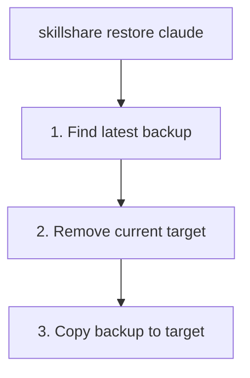

# restore

從備份還原 target。

```bash
skillshare restore                                     # Interactive TUI (browse + restore)
skillshare restore claude                              # Latest backup
skillshare restore claude --from 2026-01-19_10-00-00   # Specific backup
skillshare restore claude --dry-run                    # Preview
```

## 何時使用

- sync 出錯，需要把 target 還原到先前的狀態
- 不小心從 target 移除了 skills
- 想互動式瀏覽備份版本並與目前狀態比較

## 互動式 TUI

在 TTY 中，不帶參數執行 `skillshare restore` 會先詢問要從備份還是從垃圾桶還原。選擇備份時，先選 target 再瀏覽它的備份版本：每個版本會顯示日期、大小，以及和目前 target 相比會新增或移除哪些項目，也可以在這裡刪除舊版本。選擇垃圾桶則會開啟 trash TUI。按鍵列在畫面底部。

使用 `--no-tui` 跳過 TUI，改顯示純文字的備份清單。

## 執行流程



## 選項

| Flag | Description |
|------|-------------|
| `--all` | Legacy global skills branch; restore agents separately |
| `--project, -p` | Restore named skills or agents from `.skillshare/backups/` |
| `--global, -g` | Use global mode (default for skills) |
| `--from, -f <timestamp>` | Restore from specific backup |
| `--force` | Replace a non-empty destination folder |
| `--dry-run, -n` | Preview without making changes |
| `--no-tui` | Skip interactive TUI, show backup list instead |

`restore` 也接受一個位置參數（positional kind argument）：`skillshare restore agents claude` 會還原 `claude` target 的 agent 備份。

## 尋找備份

列出可用的備份：

```bash
skillshare backup --list
```

```
Backups  ~/.local/share/skillshare/backups
  2026-01-20_15-30-00  claude, cursor · 4.2 MB
  2026-01-19_10-00-00  claude · 2.1 MB
  2026-01-18_09-00-00  claude, cursor · 4.0 MB

3 backups, 10.3 MB

Next
  skillshare restore <target> --from <timestamp>  roll a target back
```

## 範例

```bash
# Restore from latest backup
skillshare restore claude

# Restore from specific backup
skillshare restore claude --from 2026-01-19_10-00-00

# Preview restore
skillshare restore claude --dry-run

# Force restore (skip confirmation)
skillshare restore claude --force
```

## 還原之後

`restore` 會用快照的內容取代整個 target 目錄。因為備份只保存本機內容——symlink 的 skills 會被排除，參見[備份內容](/docs/reference/commands/backup#what-gets-backed-up)——之後請執行 `sync` 把已同步的 skills 帶回來：

```bash
skillshare restore claude    # Restore local content from backup
skillshare sync              # Recreate symlinks for synced skills
```

還原後的內容是一般檔案，不是 symlinks。如果 target 一直以來只存放本機的 skills，單獨執行 restore 就已經足夠。

## 使用情境

### 意外刪除

如果你不小心刪除了某個 skill：

```bash
skillshare restore claude --from 2026-01-19_10-00-00
```

### 復原變更

如果 sync 出了問題：

```bash
skillshare restore claude  # Go back to pre-sync state
```

### 測試

還原以測試舊版本的 skill：

```bash
skillshare restore claude --from 2026-01-15_10-00-00
# Test old skills...
skillshare sync  # Return to current state
```

### Agent 還原

Agent 還原的方式與 skill 還原相同，但操作的是由 `backup agents`（以及 `sync agents` 前的自動備份）建立的並行 `<target>-agents` 備份條目：

```bash
skillshare restore agents claude                       # Latest agent backup for claude
skillshare restore agents claude --from 2026-01-19_10-00-00
skillshare restore agents claude -p                    # Project agents
```

## 專案 skills 復原

在專案根目錄中明確指定項目名稱：

```bash
skillshare backup --list -p
skillshare restore goose --from 2026-01-19_10-00-00 -p --dry-run
skillshare restore goose --from 2026-01-19_10-00-00 -p --force
```

這會復原既有的專案 skills 快照；手動 `backup -p` 仍須使用 `agents`。即使在專案目錄中，一般 skills restore 和 `-g` 仍使用全域備份。不帶名稱的 `restore -p` 是用法錯誤；互動選擇仍僅用於全域。原有 `--all` 即使搭配 `-p` 也走全域 skills 分支，請另外復原 agents。

已識別的 `goose-moved-2e676f6f73652f736b696c6c73` 項目復原到 `.goose/skills`，不改動目前的 `.agents/skills`。後綴是正規化相對目錄的十六進位編碼。target 和舊路徑定義必須仍可識別；缺失或有歧義的對應會被拒絕。使用清單中的完整名稱及 `--from`、`-p`，取代非空目錄時加上 `--force`。既有儀表板 Backup 復原使用相同對應。

復原會取代整個目標資料夾，且不包含符號連結內容，不改變目前的 profile。再次 sync 前應把要保留的編輯存入 source：sync 可能清理舊目錄中復原的未修改項目。

透過 `skillshare backup --list` 列出備份時，agent 備份會以帶有 `-agents` 後綴的獨立條目顯示（例如 `claude-agents`）。

## 另請參閱

- [backup](/docs/reference/commands/backup) — 建立與管理備份
- [sync](/docs/reference/commands/sync) — 還原後重新同步
- [Agents](/docs/understand/agents) — Agent 資源模型
